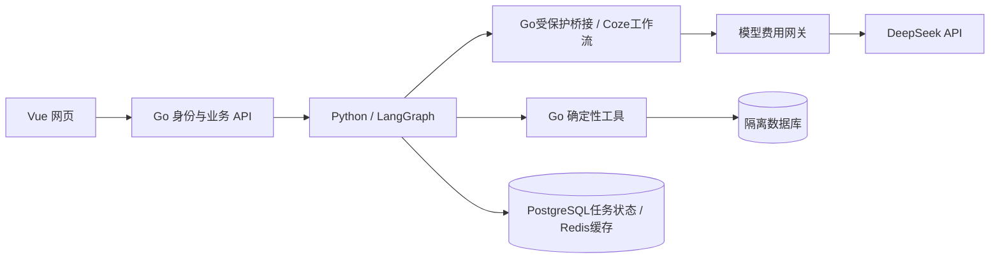

# 轻融金 AI Banking

轻融金是一套网页端 AI 财务助手原型：用户查询和导入账单、分析消费、制定节省计划，并在明确授权后体验模拟金融操作。AI负责理解与解释，Go服务负责金额计算、账户归属、工具权限和执行状态。

**需求示例：**“我下个月想少花500元，不减少必要餐饮，哪些支出可以调整？”

系统先检查所选账户的账单和数据完整性，再给出有来源的分析、可选行动、替代办法和复盘方式。条件测算不会被记为已经节省的金额。

[功能与边界](#功能与边界) · [构建与测试](#构建与测试) · [完整部署](DEPLOYMENT.md) · [代码索引](CODE-INDEX.md) · [测试说明](TESTING.md)

## 功能与边界

| 场景 | 可以操作的功能 | 实现边界 |
|---|---|---|
| 智能转账 | 收款人管理、模拟转账、定时任务、AA账单 | 不向真实银行或支付渠道发指令 |
| 账单分析 | CSV预览与授权补录、分类统计、异常识别、月度/年度报告 | 查询后端持久数据；随库样本为合成账单 |
| 理财操作 | 模拟风险测评、产品比较、申购与赎回 | 产品和金融执行为本地模拟 |
| 卡片管理 | 模拟申请、额度调整、交易限制、解锁与挂失 | 不申请、修改或挂失真实银行卡 |
| 订阅/代扣 | 周期识别、成本与扣费记录、续费提醒、取消意向 | 取消为本地模拟，不联系真实商户 |
| 跨场景联动 | 已登记生日提醒、庆祝资金预留、鲜花/蛋糕模拟订购 | 生日由用户提供，不自动读取联系人或推断关系 |

此外提供储蓄目标、动态资金规划、任务历史、刷新恢复和授权审计。入口分别见前端的[账单页](frontend/ai-banking/src/pages/Billing.vue)、[助手页](frontend/ai-banking/src/pages/Assistant.vue)、[场景页](frontend/ai-banking/src/pages/Scenarios.vue)与[安全中心](frontend/ai-banking/src/pages/Security.vue)。

### 真实 AI 验证到了哪一步

已在隔离环境完成一项真实账单任务：Vue → Go → Python/LangGraph → 自托管 Coze Supervisor v0.0.10 / Billing v0.0.9 → DeepSeek → Go只读工具 → 隔离SQL → Vue。

该用例使用61笔合成账单，Go计算收入5000元、支出3900元；模型给出可选购物延期、使用或维修现有物品、每周复盘的建议。两次真实请求共使用1529 token。此前还完成过六类只读自然语言用例，但这些历史结果不代表任意新问题都已验收。

尚未证明实际节省500元或完成真实七天复盘；正式供应商消费账单尚未完成对账。新部署默认不具备真实模型调用资格，需要自己的配置、费用审批和执行计划独立确认。操作流程见[真实模型接入手册](deploy/banking/REAL-MODEL-RUNBOOK.md)。

## 一次典型使用流程

1. 登录并选择本人账户，在账单页上传CSV、查看预览，通过补录确认后保存。
2. 选择月份，检查报告、分类与数据完整性，再提出节省目标。
3. 有效模型准入配置下，助手生成结构化任务，受限工具读取获准数据，返回结论、依据、局限和建议；未配置时显示明确拒绝。
4. 保存建议或确认规划只记录采纳决定。转账、申赎、取消等操作仍需分别准备意向、本人授权和执行。
5. 在任务历史查看状态和来源，刷新后继续查看；未知模型请求不自动重放。

## 系统如何工作



模型响应经过结构、工具白名单和账户绑定校验，结果经原任务链返回页面。模型不能直接写金融数据库。金额使用确定性业务逻辑计算，费用请求使用同一审批、预占和幂等账本；金融操作使用独立的 `prepare → authorize → execute` 流程。

## 构建与测试

从完整仓库开始，不要只下载某个服务目录。Go服务通过本地 `replace` 依赖 `backend/`。

| 组件 | 依赖 | 代码 |
|---|---|---|
| 网页 | Node.js 22、npm锁文件 | [frontend/ai-banking](frontend/ai-banking) |
| 金融服务与费用网关 | Go 1.26.9 | [services/banking-service](services/banking-service) |
| Agent | Python 3.13、uv；版本由uv.lock锁定 | [services/banking-agent-service](services/banking-agent-service) |
| 集成运行 | Docker Linux Engine、PostgreSQL、Redis；兼容MySQL路径见部署说明 | [deploy](deploy) |

先做不需要供应商凭据的源码验证，以下命令不会启动完整应用：

```powershell
git clone https://github.com/CZJ18/qingyingjin-ai-banking.git
cd qingyingjin-ai-banking

cd services/banking-service
go test -buildvcs=false ./internal/orchestrator ./internal/coze ./internal/modelgateway ./cmd/model-gateway ./internal/modelspend
go build -buildvcs=false ./cmd/server ./cmd/model-gateway

cd ../../frontend/ai-banking
npm ci
npx vitest run --config vitest.nonpaid.config.ts
npm run build
```

前提是使用全新检出目录和未注入真实供应商环境变量的终端，不添加真实供应商配置。Python测试、SQL集成专项和浏览器检查见[测试说明](TESTING.md)。运行网页与后端需要完成独立数据库、角色、内部服务地址和Nginx代理配置，按[部署说明](DEPLOYMENT.md)操作；不能仅凭构建成功或静态首页200认定全栈可用。

## 仓库包含什么

- `frontend/ai-banking/`：Vue页面、类型、API客户端和测试。
- `services/banking-service/`：Go业务API、确定性工具、执行授权、费用网关及测试。
- `services/banking-agent-service/`：FastAPI、LangGraph、持久任务、迁移与测试。
- `coze/banking/`：角色提示词、Schema、工作流生成器与已验证Canvas快照。
- `deploy/`：Dockerfile、Compose、初始化脚本、非敏感配置示例。
- `sample/`：合成账单样本；`backend/`和`idl/`保留实际依赖的Coze底座。

这是报名页面“源码与部署材料”对应的仓库。技术文档、答辩PPT、安全自评在报名网站各自栏目提交；录像、插画、讲稿和验收导出由操作者本地保管。仓库及源码ZIP不携带它们，也不携带真实账单、供应商Key/PAT、有效审批或独立执行确认。

## 上游许可与原创范围

Coze底座来自 [coze-dev/coze-studio](https://github.com/coze-dev/coze-studio)，保留原版权头和 [Apache-2.0许可](LICENSE-APACHE)。本项目的银行业务、网页、Agent接入和费用控制路径见[代码索引](CODE-INDEX.md)，第三方范围见[第三方说明](THIRD-PARTY-NOTICE.md)。
