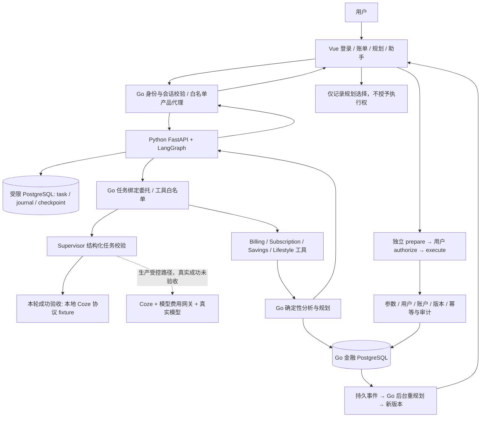

# 轻融金业务闭环增量整改交付（2026-10-20）

本轮已修改 Go、Python/LangGraph、Vue 和 OpenAPI，并完成独立数据库、真实浏览器、授权执行及后台恢复验证。**成功端到端的自然语言规划器明确使用本地 Coze 协议 fixture；没有调用真实大模型、真实银行或真实商户，没有正式供应商账单对账，没有发布生产。** 未按任何“总体完成百分比”评价项目。

所有本轮证据位于 [独立证据目录](../output/banking-improvement-20261020-1725/)。最新完整验收见 [acceptance-index.json](../output/banking-improvement-20261020-1725/acceptance-index.json)，逐命令、退出码和计数见 [test-summary.json](../output/banking-improvement-20261020-1725/test-summary.json)。历史报告只用于定位，不作为本轮通过依据。

## 功能整改清单

|业务问题|实际修改|验证范围|
|---|---|---|
|归一化账单分类与原始交易筛选不一致|共享分类词典；新增 `canonical_category`，Vue 使用该参数；保留 `category` 原始精确筛选。SQL 与 Go 一致处理 Unicode 空白|PostgreSQL、MySQL 的真实 HTTP、分页 total/items、中文/英文别名、未知分类、制表符/全角空白|
|订阅 timezone 400|DTO、Go Agent 校验、公开/Coze OpenAPI 统一接受可选 UTC/Asia/Shanghai；未知值仍拒绝|输入规范化、Agent 回归及契约检查。当前 Vue 原来已发送空对象，本轮没有把历史故障误称当前浏览器新复现|
|短时间窗漏识别周期|默认查询结束时间前1096天；从账单自动追加核查时保留账户/结束时间，使用订阅自身历史窗口|周、月、季、年度三次独立观察；页面实际导入2024/2025/2026年三笔数据并识别年度候选|
|本地取消措辞|按钮及筛选明确“取消模拟订阅”“本地已取消”；沿用服务端无商户保证状态|实际页面候选→独立授权确认→本地取消；余额没有因避免未来支出增加|
|资金解释与收入缺失|每档说明实际余额、各项保护资金、可支配资金、目标需求、安全上限及比例；未来收入未知时显式提示保守按零处理|确定性引擎、资金约束回归；没有把未来收入或避免支出加为现金|
|多目标优先级|可选 `goal_priority_ids` 必须为所选目标的完整排列；不填写继续按需求比例；Vue 可选优先分配并调整顺序|精确分配、越界/重复目标拒绝、实际页面保存及 SQL 结果|
|目标期限缺少反馈|快照读取目标期限；每目标显示期限所需月均进度与缺口；本月已存计入总进度且不重复计算|已完成当月存入、未满足期限、多目标安全资金；月度估算不承诺具体日期一定达成|
|编辑遗漏原有假设|Vue 保留原有生活目标绑定，并可明确填写/保留未来收入假设和目标优先级|类型构建、实际页面规划及刷新读取|
|缺 CSV 接入和来源追溯|新增 `/transactions/import/preview`、`/transactions/{id}/source` 与 Vue 导入入口；严格字段映射/金额/币种/时间/状态/上限校验|预览零写入；逐笔通过既有授权网关补录为 record_only；原始行、文件/行摘要、映射和时区持久化|
|来源与标准化金额可能脱节|准备及执行调用共用重解析校验，原始行必须能计算出相同的金额、方向、时间、商户、分类等字段|篡改金额、时间和方向拒绝；来源只能供本人读取。该一致性不能证明账单真实来自银行|
|未来银行连接边界|只读 Adapter 接口定义连接状态、scope、同步时间和撤销；提供明确的内存模拟适配器|归属、分页、撤销后拒绝、返回快照不允许修改内部记录；未接入产品持久连接管理|
|数据库暂停时就绪检查悬挂|Python 每依赖有界探测，最多一个在途操作；并行探测、2秒等待，启动也使用同一受限探测|单元测试及实际 PostgreSQL pause/unpause，失败返回503，恢复后能读原结果|

新增优先级、期限和原始来源使用现有 JSON 字段；**本轮没有新增或改写数据库迁移**。隔离 Go 库沿用 schema021，Python 库沿用 migration003；生产库未迁移。

## 实际业务链路



本轮 **Vue→Go→Python/LangGraph→Go 确定性工具→SQL→Vue** 使用真实组件。Supervisor 的任务规划响应来自明确的本地 HTTP fixture。该 fixture 只存在于隔离测试脚本，以 `BANKING_ENVIRONMENT=test` 和回环地址使用项目原有协议测试模式；没有增加生产模型备用路径。**它没有运行真实 Coze 引擎，也没有覆盖真实模型费用网关的成功端到端。** 费用网关在另一套明确的 SQL/供应商协议 fixture 测试中验证，不能拼接成真实模型成功。

角色权限沿用现有注册表：Supervisor 只规划图、请求确认或准备操作；Billing 读取并分析账单；Subscription 识别、查成本、准备取消意向；Savings 查询/重算已有确定性规划；Lifestyle 读取或编译受约束生活规划。Goal 使用现有 Go 目标解析/编译链路，不另外新增一个具有资金写权限的 Python Agent。模型解释不能替换 Go 输出的金额或授权状态。

## 测试与场景验收

以下命令均从相应项目目录执行；隔离配置只经本轮私有文件注入，公开日志不包含其值。Go 计数为测试事件，包含子测试，不能与 pytest 用例数简单相加。

|命令|退出码|结果|组件与限制|
|---|---:|---|---|
|`go test -json ./... -count=1`|0|543通过、0失败；36有测试包通过，12包无测试文件|当前 Go 工作区；单元/协议 fixture|
|`go test -json -tags integration ./tests/integration -count=1`|0|121通过、0失败、6跳过|真实新 PostgreSQL/Redis、真实 HTTP、模拟金融账户；旧 Docker 部署专项因未设置外部部署目标而跳过|
|`go test -json -tags integration ./internal/modelspend ./internal/modelgateway ./internal/modelbudget -count=1`|0|121通过、0失败、1跳过|真实 SQL 预算/预占/并发/未知持有，供应商为协议 fixture；独占冻结专项默认跳过|
|`go test -json -tags integration ./tests/integration -run 'TestCanonicalCategoryFilter\|TestCSVPreviewAuthorizedImport\|TestAdaptiveSavingsMySQL\|TestSubscriptionMySQLAPI' -count=1`|0|34通过、0失败|新 MySQL8.4.5兼容库，迁移角色与测试运行账号分开；没有授予运行账号 SUPER|
|`.venv/Scripts/python.exe -m pytest -q --junitxml=...`|0|344通过、0失败、0跳过|真实独立 agent PostgreSQL、banking_agent_app 受限角色；HTTP工具/模型测试按各测试声明使用 fake|
|`npm.cmd test`|0|16文件、97通过、0失败|Vue 客户端/组件测试，包含显式响应 fixture|
|`npm.cmd run api:generate`|0|Go及Agent DTO重新生成|契约生成通过不等于部署已更新|
|`npm.cmd run build`|0|类型检查与Vite构建通过|仍有既有图表 chunk >500kB 警告|
|`go vet ./...`、定向 `ruff check`|0|通过|定向 Python 覆盖本轮修改及回归测试|
|`python scripts/banking-improvement-runtime.py`（使用Agent项目虚拟环境）|0|真实浏览器及实际故障演练|只调用本地规划 fixture；真实供应商请求0；同一构建隔离原生进程，未替代生产镜像|

精确命令、执行时间和全部失败尝试保存在 `commands.jsonl` / `test-summary.json`。包括预期 RED、缺少测试库激活、Windows Python 路径/编码、浏览器等待条件、迁移角色不足、旧就绪探测超时和导入排序检查失败。没有删除失败日志或将其写成成功；新的修正日志分别保留。

页面验收共11项，包括：实际密码登录；通过授权网关创建目标；CSV预览和三笔历史补录；跨年订阅识别、确认及本地取消；多目标优先级规划；自然语言 fixture 任务、幂等重放及结果显示；刷新恢复；Coze协议 fixture 不可用的持久失败；退出后重新登录；“确认规划不执行资金”；授权模拟交易由实际 Go 后台事件生成新规划版本。逐项证据见 acceptance-index 指向的 browser_evidence。

成功任务实际有持久 task、Supervisor/Billing/Subscription/Savings 四条成功 journal 和9个 checkpoint。重算产生不同数据摘要及历史版本；无输入金额变化时影响可以为0，不伪造方案差异。数据库证据及页面结果保留在 index 指向的 JSON 和截图目录。

## 隔离复现方法

在 `D:\智慧农业` 的 PowerShell 中执行。前置条件是本轮隔离 PostgreSQL/Redis 容器运行、保留本机 `private/isolation.json`，以及现有 Go、Node、Agent 虚拟环境依赖可用。私有配置不能提交或复制到报告中。以下日志标签须每次使用新名称；记录器拒绝覆盖已有同名日志。

```powershell
python scripts/banking-improvement-evidence.py run --isolated --directory output/banking-improvement-20261020-1725 --label recheck-core-UNIQUE --cwd services/banking-service -- go test -json -tags integration ./tests/integration -count=1
python scripts/banking-improvement-evidence.py run --directory output/banking-improvement-20261020-1725 --label recheck-browser-UNIQUE -- services/banking-agent-service/.venv/Scripts/python.exe scripts/banking-improvement-runtime.py
python scripts/banking-improvement-summary.py
```

第二条会新建唯一命名的两套浏览器测试数据库，启动本轮 Go/Python/Vue 和本地协议 fixture，执行页面及故障演练，再停止这些辅助进程；保留新增测试数据和证据。故障演练只暂停本轮隔离 PostgreSQL、只重启它启动的 Python Worker。不要并发运行该脚本，因为隔离端口固定。初始化脚本是一次性脚本，检测已有凭据即拒绝覆盖；复现不需要重新初始化或删除旧数据库。摘要会更新到最新完整证据，旧逐命令日志继续保留。

## 安全、授权、费用和恢复

- 授权网关不改变：意向、参数、账户、用户、版本/摘要绑定，授权和执行分离，重放幂等。CSV也必须经过该机制，不能通过预览或直接旧接口写入。SQL用例验证未授权、跨用户、篡改来源、重复执行和原始来源读取。
- 规划决定只记录建议选择。页面测试检查账户余额和金融操作意向数量不会因确认规划而增加；后续交易单独授权。
- 真实 Agent 库角色验证无 superuser / BYPASSRLS，任务、checkpoint和后台凭据有 ENABLE/FORCE RLS，详见 `agent-db-role.json`。Go/PostgreSQL集成夹具使用测试迁移管理员；MySQL运行测试角色拥有测试库权限，**不把这些测试角色冒充生产最小权限验收**。
- 实际暂停本轮 PostgreSQL：Go/Python readiness=503；unpause后已有成功结果仍一致。实际强杀Python Worker并重启：未完成模型协议调用保持未知，任务进入 `TOOL_OUTCOME_UNKNOWN`，本地调用计数未增加。同步数据库线程本身可能继续等待，探测仅保证最多一个在途操作和HTTP有界响应。
- 费用专项覆盖用户/月与项目预占、并发拒绝、幂等缓存、跨月未知持有和恢复。仅使用合成供应商/账单 fixture 验证结算算法；这些记录不能作为真实供应商扣费或正式对账证据。浏览器隔离路径没有导入任何官方结算，真实供应商调用为0；没有复用旧付费审批或价格快照。
- 独立审阅按 `requesting-code-review` 和 `security-best-practices` 检查本轮代码；发现的Unicode分类与当月存入期限误报均补RED/GREEN回归后修复。复核未发现本范围新的可执行高置信安全问题，不等于全项目或生产安全认证。

## 部署差异、制品和回滚

2026-10-20验收时只读观察到8088/8090/8091健康，镜像为 `product-20261019`；8090公开OpenAPI摘要与工作区不同，未包含本轮CSV预览路由。2026-10-21首次继续任务时Docker未运行、三个地址不可达，失败观察保留于 [首次复查记录](../output/banking-improvement-20261020-1725/deployment-recheck-20261021.md)。用户随后打开Docker，最新 [deployment-comparison.json](../output/banking-improvement-20261020-1725/deployment-comparison.json) 已再次确认三个地址HTTP 200，镜像仍为 `product-20261019`，公开契约仍与工作区不同且缺少CSV预览路由。**工作区修复没有自动变成现有部署修复。** 本轮没有停止、迁移或替换这些生产/既有应用容器。

Docker恢复后，本轮仅启动原有三个隔离测试容器，以新数据库完整重跑浏览器及故障演练，`runtime-recheck-20261021.log` 退出码0：11项浏览器检查通过、9个checkpoint；暂停数据库返回503、恢复保留结果；强杀Worker重启后未知任务不重放（fixture调用2→2）。最新验收索引已指向该次证据，旧证据未删除。本次没有重跑所有单元/SQL专项，前述计数仍对应各自保存的实际执行日志。自然语言使用本地协议fixture，真实供应商调用仍为0。

隔离测试新建 `qyj-improvement-20261020-{postgres,redis,mysql}`，仅映射127.0.0.1；每轮浏览器使用新 `_test` 数据库，不覆盖旧代次。辅助进程在验收后停止，数据库/证据保留。测试主机有这些夹具不代表线上已经部署。

[changes.json](../output/banking-improvement-20261020-1725/changes.json) 列出45个业务源码、契约、测试和辅助脚本的前后SHA256；文档另为本文件及实施计划。原文件归档于 `before/`，没有修复或重写不可用的根 `.git`，没有伪造Git提交。制品摘要见 [artifact-hashes.json](../output/banking-improvement-20261020-1725/artifact-hashes.json)，含Go可执行文件及Vue dist；Python从当前源码运行，未构建或发布生产Python镜像。

生产发布须独立准备：可信源码/制品对应关系、现有业务库备份恢复、专用运行角色、最终镜像与配置、真实模型价格/预算审批和出口封闭，再进行明确授权的灰度。不能直接运行旧脚本恢复直连模型。回滚本轮代码无需反向迁移：在确认无在途任务后恢复既有业务镜像/配置，保留JSON来源、计划版本、未知任务与全部费用持有；不得删幂等键、清预占或用估算费用代替正式结算。

主要工程风险：默认三年扫描可能触达既有10000流水上限，此时明确拒绝并要求缩短窗口；优先级是用户明确选择的顺序，不是模型猜测；期限按现有UTC规划月份估算，不能宣称逐日预测；API新增字段需要Go、Vue、Coze契约同步部署。

## 最终状态及解除条件

|状态|项目|边界/后续条件|
|---|---|---|
|已实现且已验证|分类一致筛选、订阅历史窗口/周期、CSV预览与受控补录/来源、目标优先级与期限反馈、参数绑定、持久任务与本地fixture链路、就绪探测和隔离Worker恢复|本轮明确列出的真实组件/模拟账户/fixture范围|
|已实现但未完成端到端验证|已有真实Coze与费用桥接生产代码、Goal/Lifestyle真实模型调用路径|本轮未以真实模型运行；历史成功不作本轮验收|
|部分实现|自然语言驱动全量资金规划、真实财务接入基础、部署一致性|本轮可复用已有绑定规划并重算；无规划时仍需结构化创建/补信息。Adapter只读边界和模拟实现未接入持久连接管理。旧部署尚未发布本轮制品|
|BLOCKED|真实模型成功、真实账户/商户操作、正式供应商账单、生产发布|分别需要新价格/次数/费用审批和受控模型凭据；官方银行/商户接口与用户明确授权；官方逐请求账单或可信官方接口；独立发布授权及生产隔离、最小权限、备份恢复/回滚验收|
|未实现|真实银行连接器、商户官方取消适配器、产品内持久银行连接授权/撤销页面、当前任务之外任意自然语言自动创建所有规划输入、逐日期限现金流预测|当前只提供接入边界/模拟器，或保留现有结构化流程；不以假实现替代|

当前可以评审和复现隔离产品闭环，不能据此宣称“真实AI财务链路全部成功”“真实商户已取消”“供应商已正式对账”或“生产整改已发布”。
