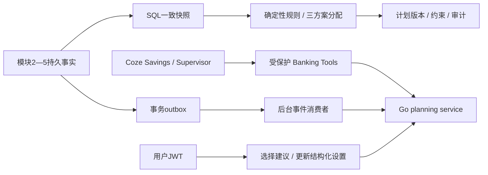

# 模块6交付：Adaptive Savings

日期：2026-10-09。实现代码位于 `services/banking-service/internal/planning`，沿用独立 Go Banking Service。没有前端或 Coze 核心源码修改。

## 实现范围

| 内容 | 实际实现 |
|---|---|
| Entity | FinancialPlan、PlanVersion、PlanConstraint、ReplanEvent、PlanDecision，现金流设置、输入快照、三方案及多目标分配结构 |
| Repository | 用户限定、SQL一致快照、原生Billing分析复用、目标版本/约束、真实账户/储蓄账本和订阅付款证据读取；版本/约束/决策/审计同事务写入 |
| 确定性引擎 | 整数CNY分、生活/必要支出/订阅待付/安全缓冲/收入风险保护，目标剩余额和已执行存入扣除；50/75/100%三方案和大整数最大余数分配 |
| 动态事件 | 005迁移的事务outbox触发器、后台轮询、用户→事件→计划锁顺序、原子确认消费、失败持久化延迟重试、事件幂等及版本唯一约束 |
| API | 创建/查询/更新计划、完整历史分页、用户建议选择、幂等事件提交、储蓄目标配置CAS更新，三个Savings工具 |
| Agent | Savings Prompt、原生Agent参考配置、可复用Plugin工作流canvas生成器；Supervisor通过工具获得结构化结果 |



当前资金只来自选定的普通模拟账户，排除被冻结账户和目标金账户。未来收入只评估收入风险；未来订阅节余只作预测。正常生活与必要支出先保护。资金不足或约束未验证时，三方案均可为0；保护资金本身不足时报告 `reserve_shortfall_minor`、`feasible=false`，不宣称存在能够覆盖全部必要支出的方案。

每个版本保存旧版号、事件号、变化原因、建议金额差额、完整输入/输出、来源ID/版本、用户/任务/审计关联和重新确认标记。建议选择绑定当前版本及数据摘要，旧源数据拒绝确认。选择建议不会创建转账、入账或改动原有操作意向。

## 实际验证

以下均执行成功，记录在 `services/banking-service/output/module6/` 及 `banking-module6-test-results.json`：

- `go test -json ./...`：101条成功测试记录，13个包通过。
- `go test -json -tags integration ./tests/integration -count=1`：74条成功记录，2个Docker专项在新镜像部署前按条件跳过。
- 补充独立执行涨价证据、工具身份、Docker后台重规划、Docker重启持久化：各1条成功记录。合计78条成功集成记录（含父测试和子测试，分批执行；不把跳过项算通过）。
- `go vet ./...`、`go mod verify`通过。
- Goal/Billing/Subscription/Savings原生工作流生成器分别2/1/2/2项测试通过，共7项；测试fixture不是实际Coze发布。
- OpenAPI主文档78路径/82操作，插件17操作；实际响应校验和路由匹配测试通过。
- 原Coze源码快照20个文件SHA256一致；001—004迁移保持不变。

关键用例包含余额不足、现金收入减少、突发必要支出、缺失预算、目标冲突/修改、订阅取消与涨价、冻结账户、越权、重复/并发事件、并发worker与手动重规划、审计失败回滚及重启重试、账本与真实余额保持一致。

本地Docker真实测试：显式创建模拟初始余额100000分的账户，规划上限55000分；显式模拟消费10000分后余额90000分，后台自动重新规划上限45000分、平衡建议33750分。服务重启后计划和余额保留，目标金始终0分。测试数据真实持久化于专用模拟MySQL；没有真实银行操作。

## 部署与启动

镜像：`qingyingjin-banking-service:module6`，实际镜像ID见 `banking-module6-health.json`。本次验证使用 `Build-Image.ps1 -LocalBinaries`：本机Go构建linux/amd64静态二进制，distroless nonroot运行。未把未执行的完整源码多阶段构建记为验证通过。

```powershell
# D:\智慧农业
./deploy/banking/Build-Image.ps1 -LocalBinaries
docker compose --env-file deploy/banking/.env -f deploy/banking/compose.yaml -f deploy/banking/compose.test.yaml up -d --no-build --wait banking-service
curl.exe http://127.0.0.1:8090/healthz
curl.exe http://127.0.0.1:8090/readyz
```

005创建五张规划表与19个事务事件触发器。已在真实MySQL重复迁移验证。首次执行触发器时遇到1419：MySQL开启binlog，schema账户缺少SUPER。已在本地独立模拟MySQL配置 `--log-bin-trust-function-creators=1`，保留数据卷重启后成功；外部MySQL须由管理员配置触发器权限及binlog策略。应用不获得SUPER权限。

实际 `/healthz` 与 `/readyz` HTTP200；mysql、redis、schema均ready；Banking服务、MySQL、Redis三个容器healthy。配置凭据与密钥没有写入交付记录。

## 对接与限制

完整输入规则、API和curl见 `services/banking-service/MODULE6.md`；契约见 `api/openapi.yaml` 与 `api/coze-plugin.openapi.yaml`。模块7使用计划版本、结构化三方案、约束与证据协调；模块8须重新核实资金、绑定具体操作并独立授权/风控，不能把本模块建议确认当作转账授权。

真实Coze实例尚未配置模型和发布这些Agent/Workflow，没有真实发布ID或模型端到端验证。已提供源码核实的原生配置、Prompt及生成工具，不宣称完成真实模型部署。

当前规划周期为UTC自然月、币种CNY、本地模拟业务。未来义务与用户现金流是明确录入的输入，不声称自动预测收入可靠性。未经结构化验证的自然语言mandatory约束会阻止非零建议，当前不自动证明任意自然语言条件成立。订阅降价未经确认不降低已采用合同义务；建议版本不替代资金执行。

文件SHA256清单见 `banking-module6-files.json`。无可用Git HEAD，因此本次交付是工作区文件，没有伪造提交、发布或PR。
