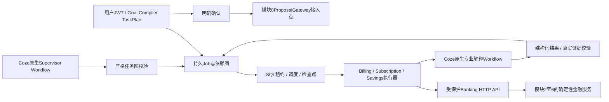

# 模块7交付：Multi-Agent Orchestrator

日期：2026-10-09。代码位于独立 `services/banking-service`。复用模块3 TaskPlan、模块4 Billing、模块5 Subscription、模块6 Planning、现有身份/错误/审计和Coze同步Workflow客户端。没有开发前端或修改Coze原生引擎。

## 架构与实际实现



Go调度器是跨原生Workflow的应用控制层，不替代Coze的Agent、Workflow、Plugin或模型引擎。LLM不持有数据库连接、JWT或工具密钥；专业执行器只有受保护HTTP客户端，不接收数据库句柄。Go控制仓储保存任务状态和审计，金融金额仍由既有Go模块计算。

| 层 | 文件 / 内容 |
|---|---|
| Entity / API DTO | `internal/orchestrator/model.go`：Job、AgentTask、AgentExecution、AgentDependency、ToolInvocation、ExecutionTrace及标准AgentOutput |
| Policy / DAG | `graph.go`：工具角色与执行模式白名单、参数、依赖、循环、优先级和结构化输出校验 |
| Repository | `repository.go`：用户限定、用户行锁、租约竞争、尝试唯一约束、任务/审计原子持久化 |
| Service / Scheduler | `service.go`、`scheduler.go`：提交、幂等、Goal Compiler对接、异步Supervisor理解、依赖调度、重试、超时、暂停恢复取消、动态核实 |
| Executor | `executor.go`：owner-bound短期JWT、关联ID、Banking API真实Schema校验、规划快照重新计算、Coze解释身份及证据校验 |
| Handler | `internal/httpapi/orchestrator.go`：用户REST、只读工具、持久SSE游标回放 |
| Migration | `006_orchestrator.sql`：新增6张调度表，复用已有金融表；001至005迁移继续按原校验和验证 |
| Coze | `coze/banking/supervisor-agent`：Prompt、Agent参考配置、JSON Schema、原生理解/解释/Plugin Workflow生成器 |
| Deployment | 配置校验、`.env.example`、Compose和模块7镜像；就绪检查要求schema版本6 |

完整修改文件与SHA256见 `banking-module7-files.json`。API及curl、目录、环境变量和模块8接口规范见 `services/banking-service/MODULE7.md`。OpenAPI主文档91路径，Plugin19个工具路径；新增Supervisor的两个查询工具不接受模型提供的user_id。

## 状态与协同边界

Job从queued、running进入succeeded/failed；另有paused、cancelled、awaiting_input、awaiting_confirmation、awaiting_gateway、blocked、review_required。只有成功依赖可解锁任务。模式由白名单决定，不允许模型声明更高权限。

默认每波最多4个只读任务并行，有副作用的建议和意向每波单个执行。支持顺序模式、优先级、最多3次尝试和100至60000毫秒超时。成功结果形成持久检查点；重启仅恢复未完成的只读任务。不确定的建议或意向中断需要人工复核，不能自动重新执行。撤销用户不会执行任务，也不会堵塞其他用户的调度队列。

账单实际重复扣费证据可自动加入一次订阅核实任务，并把核实结果加入尚未执行的Savings依赖。核实不会认定服务已经闲置、不会自动取消订阅。取消意向需要显式确认及模块8；当前网关缺失时保持awaiting_gateway，不创建本地取消意向、不调用商户、不执行取消或转账。用户也可提交完整的确认→意向→Savings依赖图；其中敏感阶段继续受网关阻止。

旧租约、取消任务和旧波次的迟到结果不能覆盖恢复后的状态。SSE只输出任务元数据，按持久事件ID回放；结束前再次排空完成事务，避免在事件读取与状态读取之间丢失最终事件。完整财务输入输出仅在受身份保护的结果/执行记录查询中可见，日志不输出原始财务载荷。

## 实际验证

原始记录位于 `services/banking-service/output/module7/`，汇总见 `banking-module7-test-results.json`：

- 全量单元测试127条成功记录，14个包通过。
- 全量带integration标记回归218条成功记录，其中包含重复执行的127条单元记录及91条真实MySQL/API记录；4个需要运行实例/重启条件的Docker测试按条件跳过，跳过不计为通过。
- 最终调度专项覆盖撤销用户、并行/顺序、依赖、失败重试、超时、异常输出、重复提交、竞争租约、暂停恢复/取消、中断复核、模型规划和Goal Compiler强制约束。
- SSE专项2条成功记录，包含模拟“完成事务恰在回放中提交”的确定性回归。
- 实际Docker worker专项与实际服务重启持久化专项分别成功；明确模拟初始余额50000分，协同完成后及重启后余额/账本保持50000分，已完成调用没有重复执行。
- `go vet`、`go mod verify`成功。原生Workflow生成器11项测试通过，其中Supervisor4项；fixture不是真实模型联调。
- 模块1保存的20个Coze源码SHA256一致，005迁移与模块6文件清单SHA256一致；旧迁移均由实际Apply校验。

测试数包含父测试和子测试，专项可能重复父项；不能将这些数字累加为独立业务用例数。最终运行实例、镜像ID和健康请求结果见 `banking-module7-health.json`。

## 启动与后续接入

```powershell
# D:\智慧农业；保留已有MySQL/Redis卷和模拟数据
./deploy/banking/Build-Image.ps1 -LocalBinaries
docker compose --env-file deploy/banking/.env -f deploy/banking/compose.yaml -f deploy/banking/compose.test.yaml up -d --no-build banking-service
curl.exe http://127.0.0.1:8090/healthz
curl.exe http://127.0.0.1:8090/readyz
```

实际验证使用本机Go构建linux/amd64静态二进制及distroless nonroot镜像；没有把未执行的源码多阶段Docker构建计为成功。

尚未完成的外部接入：真实Coze模型、PAT和已发布Workflow ID没有配置，因此没有真实LLM端到端运行证明；当前提供可检查的原生配置、生成器及HTTP契约fixture。需要在Coze原生管理端按Supervisor README选定实际模型并发布，将真实ID填入环境变量。`use_coze=false`的结构化任务和持久TaskPlan可以直接使用。

模块8需实现ProposalGateway，并校验持久任务归属、确认、控制状态、订阅版本及InvocationKey，生成pending_approval模拟意向。最终资金/取消执行需要独立授权风控接口，始终不加入模块7的模型工具白名单。
