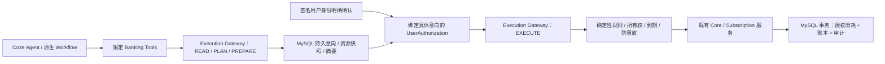

# 模块8交付：Trusted Banking Execution Gateway

日期：2026-10-09。代码位于独立 Go Banking Service；没有开发前端，没有修改 Coze 原生 Agent、Workflow 或模型引擎。账户和交易全部为本地模拟数据。

## 架构及权限



网关在独立 Banking Service 内实现，权限与资金执行独立于大模型。资金领域服务使用 `risk.TrustedGateway`，重新从当前SQL事务读取意向与用户授权；只放置context标记、伪造权限字符串或修改模型输出都不能获得执行权限。Agent执行器改用绑定专业角色及任务、最长两分钟的JWT，不再使用人类资金执行JWT。

人类授权绑定 operation_id、user_id、kind、金额、源/目标账户、规范化参数、资源快照、资源摘要、确认随机值及到期时间。持久 UserAuthorization 保存具体摘要、用户签名会话关联ID及消耗时间，不保存原始JWT。用户必须从准备响应核对实际操作，再向用户API提交 decision、intent_digest、confirmation_nonce；`confirmed=true`作为未知字段拒绝，既有模拟资金布尔字段不再作为生产授权证据。

READ只查询；PLAN生成建议；PREPARE创建待授权意向；EXECUTE要求真实签名用户及持久授权。工具插件只有准备、查询接口，不能确认或执行。工具身份由服务端绑定；user_id、Agent角色或自定义HTTP头不能提升权限。公开API没有JWT签发入口，用户凭证仍由可信操作者本地签发，原生Coze插件只配置独立工具密钥。

## 实现目录与复用

| 层 | 实际代码 |
|---|---|
| Entity | `internal/entity/execution.go`：五个持久模型与规范化摘要 |
| Repository | `internal/execution/repository.go`：所有权、用户行锁、查询、必需审计及失败记录 |
| Prepare / consent / execution | `prepare.go`、`authorization.go`、`execute.go`、`state.go` |
| Risk Policy | `execution/policy.go` 与 `risk/trusted.go`：确定性安全约束和持久permit校验 |
| 规划复用 | `planning/execution.go`：在执行事务中复用模块6真实快照及计算引擎，无独立LLM金额计算 |
| 业务入口保护 | Core开户/交易导入/账户状态/预算/目标/转账；Subscription管理/意向/取消复用既有服务 |
| Agent对接 | `execution/orchestrator.go`：复核数据库中的任务、租约、执行尝试、参数和确认，只能PREPARE |
| Handler | `httpapi/execution.go`：七个用户路由及两个工具路由，旧敏感写入路径阻断 |
| Migration | `007_execution.sql`新增五张表及六条必需规则；001至006校验和保留 |
| Contract | OpenAPI主文档99路径，插件21路径，十一种操作参数命名Schema |
| Coze | `coze/banking/execution-gateway`：原生配置参考、Prompt、插件契约及可信用户确认边界 |

完整修改文件、SHA256、实际测试结果和健康记录分别见 `banking-module8-files.json`、`banking-module8-test-results.json`、`banking-module8-health.json`。HTTP调用、curl及错误边界见 `services/banking-service/MODULE8.md`。

## 一致性与异常

转账、储蓄存取、模拟开户资金、模拟交易入账、订阅取消、预算规则及账户状态操作均从存储的严格类型参数执行。执行事务先锁定活跃用户，再检查意向/授权及账户；同一用户的并发执行串行校验最新资金，既有双分录和账本余额机制继续使用。

授权消耗、业务结果、风险记录、状态转换和审计必须同一事务提交。审计写入失败、数据库故障或context超时会回滚；已授权意向保留供查询及在有效期内重试。已成功/失败的执行只回放持久结果，不重复入账；执行幂等键绑定具体意向和授权参数，不可跨操作复用。

状态：pending_authorization → authorized → executing → succeeded / failed，另有 rejected、expired。executing不会单独提交形成半完成资金状态。网关过期映射到旧转账投影的 failed / APPROVAL_EXPIRED，旧订阅投影支持expired；新网关为规范状态来源。拒绝、风险失败及过期同步更新旧待确认投影，不能通过旧审批接口重试绕过。

必要支出保护独立于预算中可关闭的enforce_reserve建议规则：当前月预算必要预留扣除真实已发生支出，执行时再次计算。已配置FinancialPlan则复用正常生活/必要支出、订阅义务、已知必要现金流、安全预留、现金缓冲及收入风险计算。未来收入和预计减少支出不增加余额。多个账户的共同规划按单个扣款账户保留完整安全底线，属于保守策略；未配置预算/规划时只检查已知约束，不声称识别了未知生活支出。

交易备注、商户文本和工具输出被视为数据，不能配置执行规则。Gateway支持固定操作枚举，参数严格解码，执行只使用已保存并绑定摘要的参数，不读取模型的新收款账户或金额。规则缺失、停用或版本不兼容时拒绝执行，Agent没有规则修改接口。审计保存用户、Agent、意向、授权关联、风险、状态、时间和trace/task；请求体、备注、JWT、工具密钥不进入基础访问日志。未知或未授权资源的拒绝审计不会泄露他人意向。

## 启动与验证

```powershell
# D:\智慧农业，使用已有模拟数据库和卷
./deploy/banking/Build-Image.ps1 -LocalBinaries
docker compose --env-file deploy/banking/.env -f deploy/banking/compose.yaml -f deploy/banking/compose.test.yaml up -d --no-build banking-service
curl.exe http://127.0.0.1:8090/healthz
curl.exe http://127.0.0.1:8090/readyz

# D:\智慧农业\services\banking-service
go test -buildvcs=false ./...
$env:BANKING_TEST_ENV_FILE='D:/智慧农业/deploy/banking/.env.local'
go test -buildvcs=false -p 1 -tags integration ./...
```

实际验证原始记录位于 `services/banking-service/output/module8/`，包括单元、真实MySQL/API、恶意参数与身份、绑定摘要、金额篡改、拒绝/过期、余额不足、冻结、双分录、并发、防重放、审计失败回滚、预算安全底线、未来收入保护、模块7租约、取消失败/价格版本冲突和Docker运行/重启验证。测试计数包含父测试和子测试，专项不得与全量回归累加为独立业务用例数；按条件跳过的Docker测试不计通过。

本次实际结果：146条单元通过记录，15个包通过；带integration标记的全量回归257条通过记录，16个包通过、6条条件跳过，无失败。过期授权追加审计的最终安全专项8条通过记录。`go vet`与`go mod verify`通过，模块1记录的20个Coze源码SHA256保持一致。

六条跳过均为需要真实运行地址/重启条件的Docker用例，其中模块8的模拟执行与重启用例随后单独运行通过。最终模块8镜像三个容器均healthy，`healthz`和`readyz`均HTTP200；运行实例的完整OpenAPI和插件文档SHA256与当前源码一致。实际重启后模拟转账结果、已消耗授权及余额保持持久化，再次发送原执行请求仍只有原来的两条交易记录。

## 尚未实现的外部范围

没有配置真实Coze模型、PAT和已发布Workflow ID，原生配置参考和HTTP契约测试不能当作真实LLM联调结果。没有外部银行或商户取消调用。所有金融效果在同一MySQL事务中，本地取消Simulator不允许外部副作用，因此没有分布式补偿需求；接入外部银行/商户之前，必须另行实现持久外部调用状态、幂等请求、结果核实与补偿，不能复用当前本地模拟执行器直接调用真实金融系统。


## 交付后代码审查与重新验收

2026-10-09 对模块8进行了专项代码审查，修复必要消费预留校验、Agent规划确认权限、拒绝请求审计关联及意向参数校验。最新实际执行证据和未满足项以 [模块8审查报告](banking-module8-review.md) 为准；原交付测试记录仅代表当时版本。
