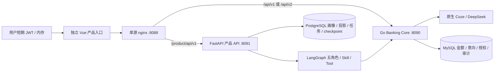

# P6：轻融金独立产品入口

本文保留 P6 阶段验收历史。当前手机号/密码登录、012 金融 schema 与新的启动组合见 [PHONE-AUTH.md](../../services/banking-service/PHONE-AUTH.md)；下述令牌入口及后续计划不作为当前状态说明。

2026-10-15。本阶段沿用仓库已有 Vue 3 / TypeScript 应用 `frontend/ai-banking`，连接 P4 FastAPI 产品 API、P5 LangGraph 任务和 Go Banking Core。原生 Coze Studio 管理界面、Go 金融账本、MySQL 及 PostgreSQL 历史保持原有职责。新增页面与真实浏览器验收结果以本轮最终交付记录为准，不能用 README 中的历史测试替代。

部署已完成本轮实际宿主机 TypeScript/Vite 构建、静态 runtime 镜像构建与 Web 容器启动，`127.0.0.1:8088` 可达。只读部署验收 25 项全部通过：SPA 刷新、Go/FastAPI 双后台健康与 OpenAPI、匿名访问拒绝、错误路径不变成首页、安全响应头及容器约束。原始记录位于 `test-results/p6/deployment.json`、`deployment-checks.json` 与 `deployment-runtime-build.log`。这不替代根任务随后进行的浏览器业务与模型验收。

2026-10-15 最终真实生产浏览器验收已通过 11 组，覆盖 DeepSeek/Coze、Supervisor、账单 Agent、生活方案与反馈、独立金融授权、审计、越权及八个移动页面。实际结果与修改文件清单见 [P6 交付记录](P6-DELIVERY.md)；原始报告为 `test-results/p6/live.json`。本阶段无数据库迁移，未实施可选 P7。

## 单一来源的业务边界



浏览器只带用户 Bearer，不能获取 JWT 签名密钥、PAT、服务间凭据或 DeepSeek Key。应用没有自动签发 token、无身份验证注册或管理员密钥输入框。用户身份在 Go 与 FastAPI 服务端重新验证；页面隐藏按钮不能代替授权检查。JWT 只驻留内存，重新加载后需重新连接。浏览器记录的任务、目标和方案引用不是金融事实；实际内容每次从当前用户 API 获取。

P5 的 `PREPARE_ONLY` 中断确认只允许创建待授权意向，不是金融授权。敏感操作保持 Go 网关的 prepare → 用户核对具体意向与参数 → authorize → execute。执行必须使用最新版本与幂等键；网络错误后先查询意向状态。生活目标不以体重变化进行金融奖惩，不自动削减正常饮食或必要支出。

## 服务接口与部署

|浏览器路径|实际服务|行为|
|---|---|---|
|`/api/v1/*`、`/api/v2/*`|Go `banking-service:8090`|原路径、请求体、用户 Authorization、Idempotency-Key 和审计关联头透传|
|`/product/api/v1/*`|FastAPI `banking-agent-service:8091`|只剥掉 `/product`，其余路径与查询参数保留|
|`/openapi.yaml`|Go|运行时完整 OpenAPI|
|`/product/openapi.json`|FastAPI|运行时 P4/P5 OpenAPI|
|`/web-healthz`|nginx|静态进程检查，不能代表银行或模型就绪|
|`/healthz`、`/readyz`|Go|Go 进程 / MySQL、Redis 检查|
|`/product/healthz`、`/product/readyz`|FastAPI|产品进程 / PostgreSQL、Redis、权限与迁移检查|

`deploy/banking-web/compose.yaml` 只新增静态 Web 服务，加入已存在的 `qingyingjin_banking-egress` 网络，默认绑定 **127.0.0.1:8088**。它不含数据库、金融环境变量或数据卷，不启动其他服务。先按 P4/P5 部署说明启动 Go、FastAPI 及其依赖，再在仓库根目录执行：

```powershell
powershell -NoProfile -File deploy/banking-web/Setup-Local.ps1
docker compose --env-file deploy/banking-web/.env -f deploy/banking-web/compose.yaml config --quiet
docker compose --env-file deploy/banking-web/.env -f deploy/banking-web/compose.yaml build banking-web
docker compose --env-file deploy/banking-web/.env -f deploy/banking-web/compose.yaml up -d --no-build banking-web
Invoke-RestMethod http://127.0.0.1:8088/web-healthz
Invoke-RestMethod http://127.0.0.1:8088/readyz
Invoke-RestMethod http://127.0.0.1:8088/product/readyz
```

访问 `http://127.0.0.1:8088`。Vite 开发入口仍是 `127.0.0.1:5178`，开发代理与 nginx 使用同一 API 前缀。`npm run build` 只构建独立 Vue 应用，不构建或替换 Coze 原生 React 应用。Docker Node 22 构建阶段通过锁文件 `npm ci` 安装依赖；运行阶段仅保留 dist 与 nginx。

Docker Hub 不可达时可显式覆盖构建阶段镜像来源；这不修改 Docker daemon 或已有容器配置：

```powershell
docker compose --env-file deploy/banking-web/.env -f deploy/banking-web/compose.yaml build `
  --build-arg NODE_BUILD_IMAGE=mirror.gcr.io/library/node:22-alpine `
  --build-arg NGINX_RUNTIME_IMAGE=mirror.gcr.io/library/nginx:1.28-alpine banking-web
```

镜像缓存机制参考 [Google 官方说明](https://docs.cloud.google.com/artifact-registry/docs/pull-cached-dockerhub-images)。Dockerfile 同名 `Dockerfile.dockerignore` 使用白名单上下文，不上传后端配置、数据库、模型缓存、前端 node_modules 或任何 `.env*`；详见 [Docker 构建上下文说明](https://docs.docker.com/build/concepts/context/)。

若镜像内 npm registry 连接失败，可在已经按锁文件安装依赖的宿主机使用本机构建方式。脚本每次重新执行 `npm run build`，TypeScript 或 Vite 失败就终止，不打包之前遗留的 dist；临时 Docker 上下文只包含本轮静态文件、nginx 配置和 runtime Dockerfile：

```powershell
powershell -NoProfile -File deploy/banking-web/Build-Image.ps1 -LocalDist `
  -NginxRuntimeImage mirror.gcr.io/library/nginx:1.28-alpine
```

本轮实际采用上述 `-LocalDist` 方式。标准源镜像构建曾在 Docker Hub 认证服务超时；可信 Google 缓存镜像可拉取，但镜像内 `npm ci` 两次出现 `ECONNRESET`，未将这些源构建记为成功。宿主机重新编译后打包的运行镜像构建与启动已通过；后续网络恢复可再验收完整多阶段源构建。

nginx 使用非 root 用户 101、只读文件系统、去掉全部 capability、no-new-privileges，临时文件只在受限 tmpfs。开启脚本仅同源、connect-src self 的 CSP，禁用 iframe/object；ECharts 与 Vue 的样式属性要求 `style-src 'self' 'unsafe-inline'`，不允许内联脚本。日志不记录查询字符串、请求体或 Authorization；页面及 API 无浏览器缓存，哈希静态资源可长期缓存。

代理不重试写请求、不缓存 API、不将错误重写为 SPA。SSE 通过同源 fetch 携带 Bearer，透传 Last-Event-ID，响应不缓冲，读超时 210 秒；断线由客户端查询服务器状态再恢复。该配置依据 [nginx proxy 文档](https://nginx.org/en/docs/http/ngx_http_proxy_module.html)。动态 Docker DNS 允许上游不可用时静态页仍加载，但 API 返回真实 502/504。

真实 DeepSeek 工作流节点配置为 120 秒，Go `BANKING_COZE_TIMEOUT=150s`，生活目标解析客户端为 180 秒。Go 模型调用上限独立放宽到 3 分钟，依赖健康检查仍最多 1 分钟；不是所有网络请求统一延长。重新部署 Go 时必须保留已有 `compose.test.yaml` 和 `compose.coze-local.yaml` 覆盖文件，避免丢失本机 Coze 网络和既有联调配置：

```powershell
powershell -NoProfile -File deploy/banking/Build-Image.ps1 -LocalBinaries `
  -ImageTag qingyingjin-banking-service:p6
docker compose --env-file deploy/banking/.env -f deploy/banking/compose.yaml `
  -f deploy/banking/compose.test.yaml -f deploy/banking/compose.coze-local.yaml `
  up -d --no-deps --no-build banking-service
```

私有 `.env` 的 `BANKING_IMAGE` 必须与构建标签一致；不要输出整份环境或 Compose 展开配置以免泄露凭据。

## API 读取示例

以下使用已经安全加载到当前 shell 的短期用户 `$env:BANKING_USER_TOKEN`；不能把签名密钥设为该值。命令只读取业务数据，不创建、授权或执行操作：

```powershell
curl.exe --fail-with-body http://127.0.0.1:8088/product/api/v1/me `
  -H "Authorization: Bearer $env:BANKING_USER_TOKEN"
curl.exe --fail-with-body http://127.0.0.1:8088/product/api/v1/profile `
  -H "Authorization: Bearer $env:BANKING_USER_TOKEN"
curl.exe --fail-with-body http://127.0.0.1:8088/api/v1/accounts `
  -H "Authorization: Bearer $env:BANKING_USER_TOKEN"
```

新前端入口没有数据库迁移；复用 Go schema 010 与产品 PostgreSQL schema 002。方案、证据、任务和金额的字段由现有 OpenAPI 提供，不能通过前端自行计算后假装后端已执行。

## 验收与尚未完成的能力

本轮验收需要分别记录单元测试、TypeScript 构建、浏览器契约测试、真实后端及模型调用、实际 nginx 代理与安全约束。未执行项明确保留为未通过或未运行。构建成功并不代表真实授权和执行链路已通过；浏览器拦截数据的测试必须与真实业务调用分开。

部署只读验收脚本不签发 JWT，不发 POST/PUT/DELETE，也不调用模型。它检查 SPA 刷新、同源安全响应头、三个服务健康、当前 OpenAPI、匿名访问拒绝、API 错误不变成 HTML 首页及容器的非 root/只读/无凭据约束：

```powershell
powershell -NoProfile -File deploy/banking-web/Verify-Web.ps1 `
  -OutputPath frontend/ai-banking/test-results/p6/deployment.json
```

真实多用户生产登录仍需后端身份服务。独立 Coze Agent 实体与 Plugin Wrapper 正式发布、金融核心 PostgreSQL 迁移、密钥数据库加密、财务健康评分、低价值订阅的长期使用证据尚属后续能力，不由产品页面自动补齐。推荐缺证据、模型错误、权限错误与过期确认应显示服务端真实状态。

本轮真实金融与浏览器验收使用隔离模拟用户 `1960014006001` 和越权用户 `1960014006002`。操作员脚本 `scripts/run-p6-live.py` 仅在进程内签发短期用户令牌，通过现有网关初始化持久化的模拟事实，然后运行 Edge 浏览器；它不拦截 API 响应。重复初始化复用固定业务外部编号和幂等键，不重复入账。运行该脚本会产生明确的模拟交易和任务，应只用于这些测试用户：

```powershell
Push-Location services/banking-service
go run -buildvcs=false ./cmd/seed -env-file ../../deploy/banking/.env.local `
  -user-id 1960014006001 -confirm-simulated-data
Pop-Location
$env:BANKING_P6_URL='http://127.0.0.1:8088'
D:/miniconda3/python.exe -X utf8 frontend/ai-banking/scripts/run-p6-live.py
```

外部模型不可用时，可显式设置 `$env:BANKING_P6_MODEL_INDEPENDENT='1'` 单独验收金融操作与界面；这份报告保存在 `test-results/p6/live-independent.json`，字段明确记录 `model_checks_skipped=true`，不能用它宣称模型链路通过。完整验收保存在 `live.json`。`tests/workbench-contract.mjs` 的 7 项检查是拦截响应的契约测试，也不是真实业务验收。
