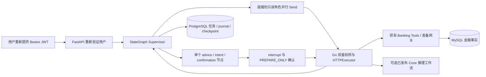

# P5：LangGraph 专业智能体、准备确认与持久化恢复

2026-10-14 实际实现与验收记录。P5 在 P4 FastAPI 产品 API 上增加真实 LangGraph 调度，复用 P1 Skill、P2 生活规划、P3 Coze 原生推理工作流及现有 Go HTTPExecutor。账户、金额、交易、预算、风控、授权和账本仍由 Go/MySQL Banking Core 提供。P6 前端与 P7 金融数据库迁移不在本阶段范围；已有 Go/Coze 调度继续处理原来的任务。

本机 PostgreSQL 002 已应用，Go/P5 健康及就绪检查均为 200。当前模型已切换为官方 DeepSeek API 的 deepseek-flash（原生 model_id=100003）；四专业角色和自然语言 Supervisor 已取得真实 workflow_execute_id 并通过 Go 输出与证据校验。完整 Python 回归 224 项通过、无跳过；Go 四个相关包及 Linux 主程序编译通过，实际 HTTP、SSE、RLS、并行、重启、中断与重复恢复均已验证。证据位于 output/p5/acceptance.json 与对应原始日志。Qwen2.5-1.5B 的三个模型文件及 parts/parts4 下载缓存已由用户执行受限脚本删除，并核实五个目标均不存在。

## 实际引擎与角色

`agent_graph.py` 直接使用 `langgraph.graph.StateGraph`、`Send`、`interrupt`、`Command` 和 `Runtime`，不是自写状态图解释器。锁文件当前固定 LangGraph 1.2.15、langgraph-checkpoint 4.3.0；依赖安装使用 `uv sync --locked`。

图包含一个 `supervisor` 调度节点与五个角色节点 `specialist_billing`、`specialist_subscription`、`specialist_lifestyle`、`specialist_savings`、`specialist_supervisor`。五个角色节点共用严格工具适配器，由角色、Skill、工具与模式限制具体能力；这不代表新增五个独立 Coze Agent 实体。



Supervisor 只派发依赖已完成的节点；就绪 `read_only` 节点可以并行，其他模式逐个推进。依赖参数只能通过 `{"$ref":"前置节点.result.字段"}` 读取声明的依赖输出；解析后重新校验。已完成输出不可被不同结果替换。收到 Billing 的可信 `verify_subscriptions` 后续动作时，可追加一个固定 `detect_subscriptions` 只读节点，仅复制经过校验的 `from/to/account_id`，不从解释文字构造金融动作。

用户可提交明确任务图，也可提交自然语言 `instruction` 与来源 `bindings`，两者必须且只能选一个。明确任务图与 `use_coze=false` 支持确定性工具执行；自然语言规划通过真实 Go→Coze Supervisor 工作流取得任务与执行证据，缺配置或模型失败时返回错误。

## Skill 与工具映射

当前仅接受 Skill version **1**，最多 32 个初始任务；重复 key、未知依赖、环、未知角色/Skill/tool/mode 组合均拒绝。输入严格禁止额外字段；节点参数最多 64 KiB、嵌套有界，金融金额使用整数分，用户身份与授权材料不得出现在任务参数中。`required_permissions` 由注册组合确定，不能由模型扩大。

|角色|Skill|工具|模式 / 权限|
|---|---|---|---|
|Billing|billing_analysis|get_transactions、get_account_summary、analyze_spending、compare_budget、detect_anomalies、generate_billing_report|read_only / READ|
|Subscription|subscription_analysis|detect_subscriptions、get_subscription_details、analyze_subscription_cost、suggest_subscription_actions、get_subscription_status|read_only / READ|
|Lifestyle|lifestyle_planning|get_lifestyle_goal、get_lifestyle_plan|read_only / READ|
|Lifestyle|lifestyle_planning|compile_lifestyle_plan|advice / READ、PLAN|
|Savings|savings_planning|get_financial_plan、compare_financial_plans|read_only / READ|
|Savings|savings_planning|replan_financial_plan|advice / READ、PLAN|
|Subscription|operation_preparation|create_cancel_intent|intent / READ、PREPARE|
|Supervisor|operation_preparation|require_gateway|intent / READ、PREPARE|
|Supervisor|task_planning|request_confirmation|user_confirmation / 不授予金融权限|

`advice` 可能持久化新的生活方案或资金规划版本，不等于只读。`intent` 在用户确认后只创建原 Go 网关的 `pending_authorization` 操作意向。P5 工具集合没有资金授权或执行工具。

## API 与用户重新认证

所有任务路由均使用用户 Bearer，经现有 Go context/users/me 验证 active 用户并绑定服务器确定的 owner_id；Agent/Tool 身份不能使用产品任务 API。客户端不能提供 owner_id 或 owner_engine。实际 Schema 见 [api/openapi.json](api/openapi.json)，运行服务提供 `/openapi.json`。

|方法 / 路径|请求与行为|
|---|---|
|POST /api/v1/agent-tasks|`AgentSubmit`；必须提供 Idempotency-Key；返回 202、`lg-UUID`、version 与 queued 状态；不自动运行|
|GET /api/v1/agent-tasks/{task_id}|当前用户任务、版本、结果、错误码与待确认挑战|
|POST /api/v1/agent-tasks/{task_id}/run|`{expected_version}`；领取租约并推进或恢复 checkpoint|
|POST /api/v1/agent-tasks/{task_id}/resume|`{expected_version,node_key,digest,nonce,decision}`；decision 为 approve/reject，先持久校验再恢复 interrupt|
|POST /api/v1/agent-tasks/{task_id}/cancel|`{expected_version}`；停止后续推进，不能追溯撤销已有操作意向|
|GET /api/v1/agent-tasks/{task_id}/events|after、limit；持久事件序号分页，limit 最大 200|
|GET /api/v1/agent-tasks/{task_id}/events/stream|短连接 SSE；after 为持久事件序号，连接期间重验身份，过期时发出 auth_expired 并结束|

同用户、同 Idempotency-Key、同请求摘要返回同一任务；变更内容返回冲突。状态包括 queued、running、interrupted、waiting_confirmation、succeeded、failed、cancelled。run/cancel 的 expected_version 使用刚读取的版本，发生冲突时先重新查询状态。

服务没有保存用户 token 的后台 worker。重启后用户需要重新提供有效 JWT，读取当前状态，并通过 `/run` 或绑定的 `/resume` 恢复；running 任务需等旧租约失效才能重新领取。已完成或已取消任务不会重新执行。

确认挑战绑定用户、任务、节点、完整节点摘要、随机 nonce、waiting_version 与十分钟有效期。`confirmation_scope=PREPARE_ONLY`；approve 仅准许准备，reject 停止任务。客户端没有 Command.update、checkpoint_id、confirmed=true 或替换参数的恢复入口。若确认已提交但进程在恢复前停止，服务读取仍有效的同一持久决定，不生成新权限。

**准备确认不是资金授权。** 准备结果仍是 `pending_authorization`，之后必须由用户独立进入原 Go 网关的 authorize → execute，接受原风控、余额、归属、版本、幂等与审计校验。`request_confirmation` 仅返回 `advice_acknowledged=true, authorization_granted=false`。所有 P5 结果保留 `financial_execution_enabled=false`。

## 运行时凭据与上游结果边界

用户 Bearer 在请求运行时 `RunContext` 中传递；短期 Agent JWT 由 Go 逐工具签发并临时使用，Python 不签发银行 JWT。独立服务凭据只保留在受控服务端配置/client 中；这三类凭据不进入 GraphState、任务请求、模型输入、checkpoint、工具结果或安全日志。`RunContext` 的 bearer/lease/tools 字段隐藏 repr，生产关闭 LangSmith/LangChain 自动 tracing，原始 Uvicorn access log 关闭。

Python 运行容器没有银行 JWT 签名密钥、Coze PAT、MySQL 连接或 PostgreSQL 管理员 URL。`AgentBankingClient` 只允许固定 Go桥/准备路由，发送 `X-Banking-Agent-Key` 与适当 Bearer，禁用环境代理和重定向，限制流式响应大小，拒绝非整数金融字段、错误任务/角色/Skill、伪造归属、错误执行状态及不可信 JSON。Lifestyle 原生文本证据与声明的可空字段按 DTO 路径校验，不能据键名把证据文本误当金额，也不放宽真实金额校验。

Go `/langgraph/run` 继续使用已有 HTTPExecutor 的原生 DTO、用户归属、确定性金额与证据校验；Python 不重新计算余额或资金方案。Coze 只接收过滤后的事实、证据和规划输入，不接收上述凭据或执行权限。

## PostgreSQL 002、RLS 与恢复语义

新增 [002_langgraph.sql](migrations/002_langgraph.sql)，不改写 001、不迁移 Go/MySQL 账本。任务固定 `owner_engine=langgraph`、task_id 为 `lg-UUID`；Go 的旧 UUID Job 不被导入或接管。

|表|用途|
|---|---|
|agent_tasks|owner、幂等键与请求摘要、状态/版本、租约、受控请求与结果|
|agent_tool_calls|每个任务/node_key 的不可变请求摘要、running/succeeded/failed/unknown 与结果 journal|
|agent_confirmations|节点摘要、nonce、waiting_version、决定、有效期与参数视图|
|agent_task_events|任务内递增 seq、状态、节点、错误码与追踪标识|
|agent_checkpoints|owner/task/namespace/checkpoint_id、parent、官方序列化 checkpoint 与 metadata|
|agent_checkpoint_writes|官方 pending writes 的 channel、write_task_id、idx、task_path 与序列化值|

六张新增表均 ENABLE/FORCE RLS，策略在 USING 与 WITH CHECK 中比较 owner_id 和事务局部 `app.user_id`。运行角色 `banking_agent_app` 非超级用户、无 BYPASSRLS、不拥有数据库/Schema/表、不继承高权限角色，只有 SELECT/INSERT 与指定可更新列，没有 DELETE/TRUNCATE/DDL。Repository 在事务内设置租户上下文，连接归还时清理；启动检查同时验证十张用户数据表的 RLS、运行角色与迁移版本 2。

`TenantCheckpointSaver` 实现官方 BaseCheckpointSaver 的同步/异步 get_tuple/list/put/put_writes 协议，恢复 CheckpointTuple、父 checkpoint 和有序 pending writes；图以 `durability="sync"` 持久化。Saver 固定当前已认证 owner 与 task，线程标识不能跨任务，写入需匹配当前有效租约。JsonPlusSerializer 禁用 pickle fallback，并限制可反序列化模块。当前不提供 checkpoint 删除、复制、裁剪、DeltaChannel 或客户端任意选点回放接口。

工具调用前先写 journal。相同节点但不同请求摘要报冲突，已成功结果直接复用。只读、原生幂等意向与使用固定调用键的生活方案编译支持有限重试；`max_attempts` 为 1..3，只有可重试依赖错误才重发。非幂等资金规划 replan 的 running/unknown 结果停止为 TOOL_OUTCOME_UNKNOWN，需要核对 Go 已有规划后再决定新请求，不能自动再创建。

租约及任务 version 为并发推进提供隔离；旧租约的任务完成、journal 和 checkpoint 写入被拒绝。取消或超时不代表上游副作用已回滚：已产生的准备意向仍需用户在原网关核实，非幂等未知结果保留未知状态。P5 不提供跨 PostgreSQL 与 Go/MySQL 的分布式事务，也不宣称所有故障都实现 exactly-once。

## 配置与启动

Go 使用 `BANKING_LANGGRAPH_SERVICE_TOKEN`，Python 使用相同值的 `BANKING_AGENT_SERVICE_KEY`。它们是独立服务密钥，不是 JWT 密钥、PAT、工具用户凭据或资金授权。`Setup-P5.ps1` 生成一次独立 32-byte 随机 hex 值并同步四份 ignored 环境文件；已有值一致时保留，冲突、短值或复用旧密钥时停止。P4 `Setup-Local.ps1` 重跑保留已有凭据。

部署镜像默认 Go `qingyingjin-banking-service:module13`、Agent `qingrongjin-banking-agent-service:p5`，可由 BANKING_IMAGE/BANKING_AGENT_IMAGE 覆盖。沿用原 localhost:8090/8091、已有 Banking 网络及原卷，Agent 测试覆盖配置额外开放 localhost:15432/16380。运行容器保持非 root、只读 rootfs、无 capabilities、no-new-privileges。

从仓库根目录执行；以下是运维步骤，不是本稿已经执行的命令记录：

```powershell
./deploy/banking-agent/Setup-P5.ps1
docker compose --env-file deploy/banking/.env -f deploy/banking/compose.yaml config --quiet
docker compose --env-file deploy/banking-agent/.env -f deploy/banking-agent/compose.yaml config --quiet
# 首次升级只应用独立 Agent PostgreSQL 新迁移；已有 001 会核对 checksum。
docker compose --env-file deploy/banking-agent/.env -f deploy/banking-agent/compose.yaml run --rm banking-agent-migrate
# 已备妥新镜像与迁移后，仅更新应用；Coze overlay 按原部署保留。
docker compose --env-file deploy/banking/.env -f deploy/banking/compose.yaml -f deploy/banking/compose.test.yaml -f deploy/banking/compose.coze-local.yaml up -d --no-deps banking-service
docker compose --env-file deploy/banking-agent/.env -f deploy/banking-agent/compose.yaml up -d --no-deps banking-agent-service
```

这组应用更新不运行 Banking 的迁移服务。禁止用 down -v、reset、清空数据库或重建金融卷完成升级。生产 Compose 固定 LANGSMITH_TRACING=false、LANGCHAIN_TRACING_V2=false。

## Coze 推理范围与实际验收

LangGraph 负责调度、依赖、中断和恢复；Coze 仍提供原生已发布模型工作流。Supervisor 输出任务计划，Billing/Subscription/Savings 解释经 Go 核验的结果，Lifestyle 只选择 Go 事实目录中的 finding_ids，Goal v2 提供目标解析。独立 Billing Query Parser 对应 BANKING_BILLING_WORKFLOW_ID，与 Billing 专业解释工作流不同；当前未配置该 Parser。工作流 ID 存在或私有状态 `published=true` 均不能代替原生实例的发布版本与真实执行证据。

P3 历史全链路验收重点为 Goal v2、Supervisor、Lifestyle；它不能替代 P5 五角色当前模型验收。原生 Plugin Wrapper 与独立 Coze Agent 实体的参考配置不冒充已导入发布。本轮已实际重启 Coze；七个工作流仅重绑模型/name/maxTokens并发布新版本，旧 release 已逐项读回核对。原生 DeepSeek builder 继续使用供应商默认思考模式，未声称配置了其不支持的开关；响应期限与证据校验保持生效。

本轮已完成的实际验收结果见下表及 output/p5/acceptance.json；模型发布配置证据为 ../../output/deepseek-config-result.json。

现有入口为 `scripts/Run-Checks.ps1 -Integration -OutputDirectory output/p5`、`scripts/verify_p5_live.py`、`--restart` 与 `--models`，以及 Go 原有测试。`verify_p5_live.py` 包含运维测试夹具初始化：它可能通过原 Go 网关 prepare/authorize/execute 创建零资金测试目标或转账目的账户；这是隔离模拟数据准备，不是 P5 服务取得资金执行能力，运行前必须核实测试数据与授权范围。模型分支已通过当前 DeepSeek 云 API 验收，不依赖本地 CPU helper。OpenAPI 导出脚本只生成实际 FastAPI Schema，不启动依赖。

后续修改以新增迁移及版本化契约推进；P6 用户界面、P7 金融数据库迁移、持久化用户 token 的 worker、自动资金执行及任意模型工具扩权均不属于 P5。

## 实际验收结果与后续边界

|检查|本轮结果与证据|
|---|---|
|Python 完整回归 / Ruff / compileall|224 passed，0 errors/failures/skipped；output/p5/pytest.xml、checks.json|
|Go API 契约、桥、身份、配置回归|4 个相关包退出 0；Banking module13/go-checks.final.json；实际 Linux 应用镜像构建退出 0|
|真实金融数据 / 五角色 / 依赖 / SSE|通过；output/p5/live.json|
|PG 六表 FORCE RLS、检查点、journal、凭据隔离|通过真实非所有者运行角色 SQL 检查；output/p5/storage.json|
|实际三容器重启、持久结果、绑定中断、重复确认|通过；output/p5/restart-control.json、live-restart.json；同一个 pending_authorization 意向，无资金授权/执行|
|DeepSeek 专业四角色与 Supervisor|通过；output/p5/live-models.json、models-exit.json；余额及版本不变|
|镜像源码、实际 OpenAPI、迁移 checksum|总证据由 scripts/record_p5_delivery.py 从实际运行环境核验生成|
|农业代码清理|93 个业务文本文件删除；Coze native 前后端编译通过，旧农业路由在有效用户会话下为404；见 ../../docs/农业代码清理.md|
|Qwen 物理文件删除|用户执行受限脚本后核实通过：三个模型文件及 parts/parts4 均不存在，见 output/p5/model-switch.json|

P6 可以基于已验收接口开发，仍需用户另行明确进入 P6。P5 不实现资金执行、持久化用户 token worker、跨数据库 exactly-once 或 P7 金融账本迁移。非幂等未知结果保持停止，需要核实来源后发起新请求。

## curl 示例

先向原 Go API 查询自己授权账户，将下方 YOUR_ACCOUNT_ID 换成实际 ID，并把 JSON 保存为 p5-submit.json；示例不包含虚构业务结果。

```json
{"tasks":[{"key":"billing","agent_type":"billing","tool":"analyze_spending","skill_id":"billing_analysis","skill_version":1,"execution_mode":"read_only","parameters":{"from":"2026-10-01T00:00:00Z","to":"2026-11-01T00:00:00Z","timezone":"UTC","account_id":"YOUR_ACCOUNT_ID"},"dependencies":[],"use_coze":true}]}
```

```powershell
$taskQueued = curl.exe -sS http://127.0.0.1:8091/api/v1/agent-tasks -H "Authorization: Bearer $env:BANKING_USER_TOKEN" -H "Idempotency-Key: my-p5-billing-1" --json "@p5-submit.json" | ConvertFrom-Json
$taskRunBody = @{expected_version=$taskQueued.data.version} | ConvertTo-Json -Compress
[IO.File]::WriteAllText((Join-Path (Get-Location) 'p5-run.json'), $taskRunBody)
curl.exe -sS "http://127.0.0.1:8091/api/v1/agent-tasks/$($taskQueued.data.task_id)/run" -H "Authorization: Bearer $env:BANKING_USER_TOKEN" --json "@p5-run.json"
curl.exe -sS "http://127.0.0.1:8091/api/v1/agent-tasks/$($taskQueued.data.task_id)" -H "Authorization: Bearer $env:BANKING_USER_TOKEN"
curl.exe -N "http://127.0.0.1:8091/api/v1/agent-tasks/$($taskQueued.data.task_id)/events/stream" -H "Authorization: Bearer $env:BANKING_USER_TOKEN"
```

确认/取消接口使用当前 task version；resume 必须提交查询得到的 node_key/digest/nonce/decision 原值。它只允许准备，不能授权或执行资金。配置 DeepSeek 使用 ../../deploy/banking/Configure-CozeDeepSeek.ps1，说明见 ../../deploy/banking/DEEPSEEK.md；不要再启动本地 Qwen helper。
