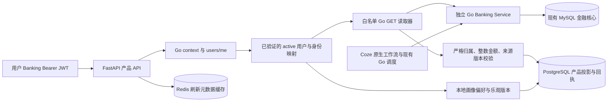

# 轻融金 Banking Agent Service：P4 产品 API 与 P5 LangGraph

当前版本为 0.5.0。P5 增加五角色 LangGraph、Skill 绑定、PostgreSQL 检查点、用户准备确认、journal 与重启恢复，详细设计与接口见 [P5.md](P5.md)。账户与账本继续使用 Go/MySQL；P5 不取得资金执行权限。P5 本轮模型验收状态及实际测试日志见 `output/p5/`，历史 P4 验收不代替 P5 验收。

以下是 P4 当期的实现与验收记录；其中“只读”“不实现 P5”均描述 P4 范围。P5 工具可以在用户绑定确认后创建待授权意向，最终 authorize/execute 仍由原 Go 网关和用户独立完成。

## P4：产品 API 与 PostgreSQL 投影

2026-10-13 实现并验收独立 FastAPI 服务。Go/MySQL Banking Core 仍是账户、交易、预算、授权、风控和账本的唯一金融事实来源。本阶段提供产品画像偏好、可追溯投影、建议和证据查询；不实现 P5 LangGraph、P6 前端或 P7 资金数据库迁移。

## 实际架构



FastAPI 每个受保护请求都重新向真实 Go API 验证 JWT 与 active 用户，不解码或签发银行 JWT，不持有 `BANKING_USER_JWT_SECRET`，不缓存身份判断。拒绝 `agent`/`tool` 身份；服务器绑定用户 ID，请求体不接受 user_id。Banking 客户端只允许固定 GET 路径，禁用重定向与环境代理，响应流上限 1 MiB。账户或来源不属于用户时，Go 拒绝；如果上游结构伪造归属，解析器再次拒绝。

产品 API 只写独立 PostgreSQL 元数据与 Redis 缓存，没有转账、授权、执行、取消订阅或修改核心预算接口。用户的 Bearer 仅转发给固定 Go 只读路由，不传给模型。Coze/P3 的原生工作流、模型和 Go 调度没有改写。

## 已实现能力

- 身份映射：Banking 用户 ID 原样保存为 owner_id，Coze ID 可选、唯一绑定；绑定冲突拒绝，不静默改绑。
- 画像：币种 CNY、IANA 时区、用户设置的安全预留偏好、revision；并发更新用 expected_version。默认 reserve=0 表示尚未设置的本地偏好，不代表实际余额、风险额度或健康评分。保存偏好不修改 Go 预算或模块8风险规则。
- 来源投影：账户、交易、订阅主记录、预算、目标 v2、生活方案、建议和操作记录。金额从 Go 原样读取为整数分，Python 不推算储蓄或可用资金。操作记录排除意向参数、确认 nonce、授权 hash/签名材料和用户授权明细。
- 证据：生活方案及其建议保存实际交易引用、audit_id、来源版本、摘要和采集时间。源备注、商户名称和目标原文属于不可信数据，不能作为系统指令；目标原文标记为 untrusted_text。P4 不把这些文本发给 LLM。
- 原子刷新：客户端仅提供 kind/source_id，由服务读取真实 Go API。所有源读取完成后才事务写入；任一读取失败不保存部分结果。同用户串行化写事务，其他用户独立。
- 幂等与乱序：同用户 Idempotency-Key 绑定原始资源列表及顺序；重复引用被拒绝。重复键返回原始回执，变更请求返回 409；旧版本不覆盖新版本，同版本不同内容报冲突。回执记录实际保留版本、传入版本、摘要与采集时间。
- 权限隔离：独立迁移角色；运行角色非超级用户、非数据库/表/Schema 所有者、无 BYPASSRLS 或高权限角色成员资格。四张用户数据表 ENABLE/FORCE RLS，用户上下文只在当前事务内生效并在池归还时清理。运行角色没有 DELETE、TRUNCATE 或 DDL 权限。角色或 Schema 不合规时应用启动失败。
- 基础能力：健康/就绪检查、脱敏结构化请求日志、OpenAPI 3.1、请求体上限、分页和统一错误 Envelope。关闭 Uvicorn 原始 URL access log，日志记录路由模板、请求/追踪 ID、状态与耗时。

**订阅版本边界**：Go 的订阅付款明细/重复扣费标记变化不保证主记录 version 更新。因此 PostgreSQL 订阅投影只保存版本化主记录，付款数据仍校验归属但不并入其 payload 或 evidence。付款历史及重复扣费证据继续通过现有 Go Subscription API 获取；本阶段没有重写订阅业务，也没有伪造聚合版本。

## 工程目录与依赖

```text
services/banking-agent-service/
  pyproject.toml / uv.lock        独立依赖与精确锁文件
  src/banking_agent/
    main.py                      FastAPI Handler / HTTP边界
    models.py                    输入与响应契约
    config.py / errors.py         显式配置与错误码
    banking.py                   身份验证、GET白名单、传输限制
    source.py                    严格的来源DTO与Projection
    repository.py                PostgreSQL租户事务与版本去重
    migrate.py                   事务迁移与checksum
  migrations/001_projection.sql
  tests/                         API、来源、客户端、真实数据库测试
  scripts/                       检查、OpenAPI导出、真实联调、交付记录
  api/openapi.json                从实际FastAPI生成
deploy/banking-agent/             Compose、环境生成与数据库角色初始化
```

依赖由 uv 管理：FastAPI、Uvicorn、httpx、psycopg3/连接池、Redis、tzdata；开发依赖 pytest/pytest-asyncio/Ruff。主机使用 Python 3.13.13，Docker 使用 Python 3.13 系列；精确库版本见 uv.lock。Docker 只安装锁定的生产依赖，镜像不包含测试脚本或银行签名配置。

## PostgreSQL 迁移与关系

新增独立 PostgreSQL **001**；Go/MySQL 原有迁移保持 **010**，没有替换金融数据库或修改历史迁移。

|表|关键字段与用途|
|---|---|
|agent_identities|owner_id PK、banking_user_id 唯一且等于 owner_id、coze_user_id 可选唯一、trace_id；用户映射|
|agent_financial_profiles|owner_id PK/FK、currency、timezone、safety_reserve_minor BIGINT、revision、trace_id；用户显式偏好|
|agent_projection_resources|owner_id FK + kind + source_id 复合主键；source_version BIGINT、payload/evidence JSONB、audit_id、source_digest、observed_at、trace_id|
|agent_projection_receipts|owner_id FK + event_id 复合主键；请求摘要、事务结果 JSONB、追踪和采集时间|
|agent_schema_migrations|版本、文件名、checksum、执行时间；仅迁移角色写入，运行角色只读|

一个用户可有多个不同 kind 投影。生活方案中的 goal_id、来源预算/报告 ID、建议 plan_id 和证据交易 ID 保留 Go 原始关系；不在 PostgreSQL 创建第二套账户、余额或资金账本。JSON 金额经严格 DTO 整数校验，画像金额为带范围约束的 BIGINT。

迁移使用 PostgreSQL 事务和 advisory lock，DDL 与 checksum 同时提交。001 已实际应用并校验，后续变更应新增迁移；不得改写 001。RLS 应用角色与所有者隔离基于 [PostgreSQL 官方 Row Security 文档](https://www.postgresql.org/docs/17/ddl-rowsecurity.html)，不能只开启 RLS 却使用所有者或超级用户运行服务。

来源版本规则：account/subscription/operation/recommendation 使用 Go version；lifestyle_goal 使用 current_version；不可变生活方案使用 created_at；交易和预算使用 updated_at 毫秒时间戳。同毫秒但数据不同仍报 409，不覆盖。投影是采集时快照，不是实时余额或执行授权；需要执行时必须重新进入模块8校验。

## API 契约与 curl

运行地址 `http://127.0.0.1:8091`；实际生成的契约为 [api/openapi.json](api/openapi.json)，服务通过 `/openapi.json` 提供，未开发 HTML 文档或前端页面。

|方法/路径|用途|
|---|---|
|GET /healthz|进程存活；金融执行能力=false|
|GET /readyz|PostgreSQL角色/迁移/RLS、Redis、Go依赖检查|
|GET /api/v1/me|经Go验证的当前用户映射|
|GET /api/v1/profile|本地偏好与revision|
|PUT /api/v1/profile|expected_version、timezone、safety_reserve_minor；乐观更新|
|POST /api/v1/projections/refresh|resources[{kind,source_id}]；Idempotency-Key必填|
|GET /api/v1/projections/events/{event_id}|当前用户持久化刷新回执|
|GET /api/v1/projections/{kind}|当前用户分页投影，limit 1..100、offset 0..1000000|
|GET /api/v1/projections/{kind}/{source_id}|当前用户的具体投影|
|GET /api/v1/recommendations|已刷新生活方案中的建议|
|GET /api/v1/recommendations/{source_id}/evidence|版本、摘要、采集时间和真实交易引用|

刷新 kind 允许 account、transaction、subscription、budget、lifestyle_goal、lifestyle_plan、operation。recommendation 仅从真实生活方案的子记录产生，可查询但不能提交虚构推荐数据。operation ID 为规范 UUID，其余为正整数的规范字符串；所有金额为整数分。

统一响应包含 code/message/request_id/trace_id/data。401 UNAUTHENTICATED；403 FORBIDDEN；404 NOT_FOUND/SOURCE_NOT_FOUND；409 IDEMPOTENCY_CONFLICT/SOURCE_VERSION_CONFLICT/PROFILE_VERSION_CONFLICT/IDENTITY_CONFLICT；502 SOURCE_OUTPUT_INVALID；503 BANKING_UNAVAILABLE/DEPENDENCY_UNAVAILABLE。输入错误为 400/422，超过实际 1 MiB 请求体为 413，均使用 INVALID_ARGUMENT。直接 Repository 的内部参数错误为 INVALID_INPUT。

查询投影及证据始终包含 source_version/source_digest/observed_at。新刷新回执的每个资源也包含这三项与 incoming_source_version；stale 返回实际保留版本，不能把旧输入当作当前投影。开发期间旧回执保持原文不改写，新增 provenance 字段在响应 Schema 中可空以兼容这部分历史。健康、身份和画像属于本地接口，不冒充金融来源快照。

在仓库根目录 PowerShell 中执行；令牌来自当前真实模拟用户，不是模型自行提供的用户 ID：

```powershell
curl.exe -sS http://127.0.0.1:8091/healthz
curl.exe -sS http://127.0.0.1:8091/readyz
curl.exe -sS http://127.0.0.1:8091/api/v1/me -H "Authorization: Bearer $env:BANKING_USER_JWT"
curl.exe -sS http://127.0.0.1:8091/api/v1/profile -H "Authorization: Bearer $env:BANKING_USER_JWT"

$refresh = @{resources=@(@{kind='account';source_id=$env:BANKING_ACCOUNT_ID},@{kind='lifestyle_plan';source_id=$env:BANKING_LIFESTYLE_PLAN_ID})} | ConvertTo-Json -Depth 10
[IO.File]::WriteAllText((Join-Path $PWD 'output/p4-refresh.json'),$refresh,[Text.UTF8Encoding]::new($false))
curl.exe -sS http://127.0.0.1:8091/api/v1/projections/refresh -H "Authorization: Bearer $env:BANKING_USER_JWT" -H "Idempotency-Key: $env:BANKING_REFRESH_KEY" -H 'Content-Type: application/json' --data-binary '@output/p4-refresh.json'
curl.exe -sS http://127.0.0.1:8091/api/v1/recommendations -H "Authorization: Bearer $env:BANKING_USER_JWT"
curl.exe -sS "http://127.0.0.1:8091/api/v1/recommendations/$env:BANKING_RECOMMENDATION_ID/evidence" -H "Authorization: Bearer $env:BANKING_USER_JWT"
```

BANKING_REFRESH_KEY 必须先设为一个唯一字符串，并在重试同一请求时保留；更换内容或顺序时使用新的键。接受建议、确认金融意向和执行不是 P4 路由，不能把本地画像或查询操作当用户授权。

## 配置、启动和实际检查

Go/MySQL/Redis/Coze 现有部署继续运行。P4 使用独立 PostgreSQL 17.6、Redis 8.0.2 与独立卷，接入已有 `qingyingjin_banking-egress` 网络。服务仅暴露 localhost:8091；测试 overlay 额外暴露 localhost:15432/16380。移除测试端口前不得错误替换现有 Banking 网络配置。

```powershell
./deploy/banking-agent/Setup-Local.ps1
docker compose --env-file deploy/banking-agent/.env -f deploy/banking-agent/compose.yaml -f deploy/banking-agent/compose.test.yaml up --build -d
./services/banking-agent-service/scripts/Run-Checks.ps1 -Integration

# 完整验收入口：实际测试、构建、部署、Go联调、三容器重启、P3持久化读取和交付记录。
./services/banking-agent-service/scripts/Accept-P4.ps1

# 真实Go金融数据来自P3已持久化的隔离模拟账户，不用硬编码HTTP成功结果。
$env:UV_CACHE_DIR='D:/智慧农业/output/uv-cache'
$env:UV_LINK_MODE='copy'
python -m uv run --project services/banking-agent-service python services/banking-agent-service/scripts/verify_live.py
python -m uv run --project services/banking-agent-service python services/banking-agent-service/scripts/verify_restart.py
python -m uv run --project services/banking-agent-service python services/banking-agent-service/scripts/export_openapi.py
```

Setup-Local 只创建缺失的文件，已有值保留；生成独立随机管理员/运行用户/Redis 凭据，`.env` 与 `.env.local` 被忽略。公开样例为 `.env.example`。运行服务只接收 DATABASE_URL/REDIS_URL/BANKING_URL，迁移容器单独接收 MIGRATION_URL；无银行签名秘密、PAT 或真实资金接口密钥。所有容器非 root、只读 rootfs、移除 capabilities，数据只写自身持久卷。

主机 uv 缓存必须与工作区在同一盘，否则本机 miniconda 查询遇到跨盘临时文件错误；Run-Checks 已设置本地缓存。需要本地 Uvicorn 时从服务目录使用 `python -m uv run uvicorn banking_agent.main:app --app-dir src --port 8091 --no-access-log`，先在进程内加载本地环境配置；默认优先 Compose，不能与已运行容器占用同一端口。

## 实际验收与问题

2026-10-13 在本机实际运行的结果：

|检查|实际结果|
|---|---|
|Ruff / compileall|退出码均为 0|
|完整 pytest（含真实 PostgreSQL 集成）|125 passed，0 failed/error/skipped；1 项 TestClient 弃用警告|
|Docker 构建、部署|成功；运行镜像与本地全部 src/migrations 哈希一致|
|healthz / readyz|HTTP 200；PostgreSQL、Redis、Go Banking 均 ready|
|真实 Go → FastAPI → PostgreSQL 联调|通过；幂等、冲突、越权、证据、整数金额及银行余额不变已验证|
|PostgreSQL / Redis / API 实际重启|三个容器启动时间均变化；同一镜像、回执、画像、投影与证据保留|
|P3 已持久化结果回归|通过；读取既有模型结果与任务，不新增模型调用|
|数据库迁移|独立 PostgreSQL 001 已应用且 checksum 一致；Go/MySQL 仍为 010|

完整结果见 [acceptance.json](output/p4/acceptance.json)，实际修改文件及哈希见 [files.json](output/p4/files.json)。文件清单描述本阶段有意修改/新增的文件，不冒充 Git diff。

检查入口 `Run-Checks.ps1 -Integration` 实际运行 Ruff、完整 pytest、compileall，并记录退出码和 JUnit。真实 PostgreSQL 测试包含强制 RLS、无用户条件查询、跨用户插入、无上下文拒绝、权限继承拒绝、禁止 DELETE/TRUNCATE/DDL、连接池上下文清理、并发重放、乱序、同版本冲突、原子回滚、画像 CAS 和回执 provenance。

真实 HTTP 联调验证 Go 身份与源读取、投影整数金额、版本摘要/采集时间、建议交易引用、重复回执、冲突 409、Agent 403、跨用户隔离和账户余额不变。重启 P4 服务、PostgreSQL、Redis 后再次读取同一回执、画像、投影与证据。另执行了 P3 持久化任务回归读取，没有声称再次调用模型。

实际日志位于 `output/p4/`：checks.json、pytest.log/pytest.xml、ruff.log、build.log/build.json、live.json、live-restart.json、restart.log/restart-control.json、p3-regression.log/p3-regression.json；最终结果 acceptance.json 与文件 SHA256 清单 files.json 由 record_delivery.py 从这些记录及当前容器生成。记录校验实际退出码、同一镜像、三个容器重启前后的启动时间、完整源码哈希与运行时 OpenAPI。`verify_live.py --restart` 单独调用只读取持久化结果，不是重启证明；请使用 verify_restart.py 或完整 Accept-P4.ps1。测试中的 MockTransport/Fake 仅用于异常边界单元测试，生产没有内存数据或 fixture 回退。

已修复：身份客户端空依赖错误就绪；画像/证据契约不完整；订阅子数据版本污染；角色继承权限检查；回执旧输入与保留版本混淆；幂等键请求顺序绑定；生产日志默认未开启；验收脚本抢在 ASGI 启动完成前请求；旧 Docker 镜像未重新部署导致的联调失败。旧失败记录保留，没有把它们记为通过。

已知边界：

- 投影由显式刷新驱动，没有新增 MySQL CDC 或后台自动全量同步；不会把不存在的资源当零余额，也不自动删除未刷新记录。
- 交易/预算来源的毫秒版本碰撞会拒绝；需要源更新或未来明确的源版本 API。投影规则升级必须同时版本化契约/迁移，不能用同版本覆盖不同内容。
- 订阅付款历史仍在 Go；FastAPI 当前不复刻 Billing/Savings 算法或财务健康评分。画像偏好还未转化为 Go 风控规则。
- FastAPI TestClient 当前发出 httpx 兼容层弃用警告；测试实际通过，生产客户端使用 httpx，不调用 TestClient。
- P5 Agent 服务身份委托、LangGraph checkpoint/owner_engine 和 P6 产品入口尚未实现；未替换金融执行网关。

**P5 已具备工程前置条件**：身份信任、来源投影、建议/证据契约、RLS 与恢复验收可用。下一阶段必须新增明确的 Agent 委托权限与唯一 owner_engine，不应向模型提供 Bearer、签名秘密或数据库连接；旧 Go 任务继续由 Go 处理，新 LangGraph 任务由新引擎单独持有。
