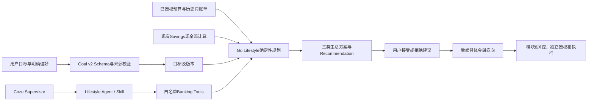

# P2：Lifestyle 与目标 v2

P2 保留 Go/Gin/GORM/MySQL 和 Coze 原生能力。新增确定性生活方案服务，没有开发前端、没有改写 Agent/Workflow 引擎、没有替换金融账本。

## 实际能力

- 独立 `goal-v2.schema.json` 与来源校验；`expense_reduction_monthly_minor` 和 `savings_monthly_minor` 分开，少花不能自动解释为储蓄。周期、金额和用户允许调整的类别必须有原文证据。禁止依据体重或限制饮食生成金融奖惩。
- 目标创建、乐观版本更新和历史保存；v1 的 Parsed 和 Schema 不变。
- 读取已授权的持久化 Budget、完整历史月 BillingReport，复用 Billing 分类和 Savings 现金流计算。账户筛选报告、当前未结束月份、缺少预算或缺少明确调整偏好均不给出虚构金额方案。
- 正常饮食、住房、医疗、通勤（含分类别名）全额保护；用户额外保护类别和必要预留同时生效。
- 保守/平衡/积极三类建议。可调整上限来自历史消费与预算，不能把未使用的预算额度当实际消费节约。支出预测和当前现金储蓄上限分开；冲突保留原目标和缺口，允许建议储蓄零元。
- 持久化生活预算方案、来源摘要、交易证据、Recommendation、用户接受/拒绝、审计。确认绑定建议版本和方案摘要，过期、来源变化、目标更新、重复决定受控。选择方案不产生 UserAuthorization，不改账户余额或核心预算。
- `lifestyle_planning@1` 注册 `get_lifestyle_goal`、`get_lifestyle_plan`（只读）和 `compile_lifestyle_plan`（advice）。Supervisor 复用现有调度器调用受保护 API，持久化任务与轨迹。Lifestyle Agent 无用户目标修改、建议确认或金融执行权限。

## 目录与依赖

```text
internal/lifestyle/        Entity / Repository / Service / Engine / Schema / Parser
internal/billing/category.go   复用分类算法的只读入口
internal/goal/evidence.go      复用整数分来源校验，v1 行为不变
internal/planning/lifestyle.go  在同一数据库事务内重算现金流
internal/httpapi/lifestyle.go  已认证 v2 REST 和原生插件工具
internal/migration/010_lifestyle.sql
coze/banking/lifestyle-agent/  Prompt、工作流参考和真实源码适配器
```



算法不持有资金写入依赖。Repository 复用已有幂等表，并在事务内锁定 active 用户；目标、来源读取、方案、建议和成功审计事务一致。外部模型调用不占用数据库事务。

## 迁移

迁移前最大编号 009；新增 010，不改历史迁移内容或校验和。创建五张表：

|表|用途|关键约束|
|---|---|---|
|banking_lifestyle_goals|v2 目标与当前版本|用户外键|
|banking_lifestyle_goal_versions|目标原文、Spec、版本、追踪|goal/version 唯一、复合归属外键|
|banking_lifestyle_plans|预算方案、来源和结果 JSON、摘要、期限|目标归属外键|
|banking_lifestyle_recommendations|方案选项、预测影响、规则、状态和版本|plan/type 唯一、用户归属外键|
|banking_lifestyle_decisions|独立用户偏好决定与审计|每建议一次决定、归属外键|

金额采用 BIGINT 整数分；不增加资金账本或余额写入接口。

## API 与 curl

完整契约：`api/openapi.yaml`；原生插件：`api/coze-plugin.openapi.yaml`；运行服务通过 `/openapi.yaml` 和 `/coze-plugin.openapi.yaml` 提供相同文档。

|接口|用途|
|---|---|
|POST /api/v2/lifestyle-goals|创建经来源验证的结构化目标；幂等键必填|
|POST /api/v2/lifestyle-goals/parse|真实配置的 v2 Coze 解析；未发布返回 COZE_UNAVAILABLE|
|GET /api/v2/lifestyle-goals/{id}|当前目标和版本分页，limit 1..100、offset 0..1000000|
|PUT /api/v2/lifestyle-goals/{id}|绑定 expected_version 更新，旧待确认建议失效|
|POST /api/v2/lifestyle-goals/{id}/compile|绑定目标版本和已授权来源，保存方案|
|GET /api/v2/lifestyle-goals/{id}/plans|方案历史分页，默认最近 100 个，支持 limit/offset|
|GET /api/v2/lifestyle-plans/{id}|读取指定历史方案及建议|
|POST /api/v2/recommendations/{id}/decisions|用户决定，绑定版本、摘要及幂等键|
|GET /api/v2/recommendations/{id}/decisions|用户决定历史|
|POST /tools/v1/lifestyle/get_lifestyle_goal|原生插件查询目标；goal_id/plan_id 二选一，另一值为字符串 0|
|POST /tools/v1/lifestyle/get_lifestyle_plan|原生插件查询生活方案|
|POST /tools/v1/lifestyle/compile_lifestyle_plan|原生插件生成建议；goal_id + CompileInput，幂等键必填|

错误沿用统一 Envelope：400 INVALID_ARGUMENT、401 UNAUTHENTICATED、403 FORBIDDEN、404 NOT_FOUND、409 VERSION_CONFLICT/STATE_CONFLICT/IDEMPOTENCY_CONFLICT、422 MODEL_OUTPUT_INVALID/INPUT_REQUIRED、503 COZE_UNAVAILABLE/DEPENDENCY_UNAVAILABLE。缺少预算属于成功编译的 `needs_information`，其 options 为空，不返回猜测金额。

PowerShell 示例（JWT 为对应模拟用户的有效令牌，预算/报告/计划 ID 必须真实且归属该用户）：

```powershell
$jwt = $env:BANKING_USER_JWT
$goalBody = @{
  text = '未来三个月保持规律饮食，每月少花1000元，每月储蓄200元，可以调整shopping，禁止转账'
  expected_version = 0
  spec = @{
    schema_version='2.0'; currency='CNY'; period_months=3
    expense_reduction_monthly_minor=100000; savings_monthly_minor=20000
    health_background=''; adjustable_categories=@('shopping')
    protected_categories=@(); prohibited_operations=@('transfer')
    evidence=@{
      period_months='三个月'; expense_reduction_monthly_minor='每月少花1000元'
      savings_monthly_minor='每月储蓄200元'
      'adjustable:shopping'='可以调整shopping'; 'prohibited:transfer'='禁止转账'
    }
  }
}
$goalBody | ConvertTo-Json -Depth 12 | Set-Content -Encoding utf8 goal-v2.json
curl.exe -X POST http://127.0.0.1:8090/api/v2/lifestyle-goals `
  -H "Authorization: Bearer $jwt" -H 'Content-Type: application/json' `
  -H "Idempotency-Key: $([guid]::NewGuid())" --data-binary '@goal-v2.json'

# 从响应取得 goalId 和版本；使用既有 Banking API 创建的授权预算/账单/资金计划。
@{expected_version=1;budget_id="$budgetId";billing_report_id=$reportId;financial_plan_id="$financialPlanId"} |
  ConvertTo-Json | Set-Content -Encoding utf8 compile-v2.json
curl.exe -X POST "http://127.0.0.1:8090/api/v2/lifestyle-goals/$goalId/compile" `
  -H "Authorization: Bearer $jwt" -H 'Content-Type: application/json' `
  -H "Idempotency-Key: $([guid]::NewGuid())" --data-binary '@compile-v2.json'

@{expected_version=$recommendationVersion;decision='accept';plan_digest=$planDigest} |
  ConvertTo-Json | Set-Content -Encoding utf8 decision-v2.json
curl.exe -X POST "http://127.0.0.1:8090/api/v2/recommendations/$recommendationId/decisions" `
  -H "Authorization: Bearer $jwt" -H 'Content-Type: application/json' `
  -H "Idempotency-Key: $([guid]::NewGuid())" --data-binary '@decision-v2.json'
```

没有金融计划时传 `financial_plan_id="0"`；如果存在非零储蓄目标则要求补充资金依据。预算/报告缺失分别传字符串 `0` / 空字符串，不能引用猜测 ID。

## 启动与复验

从仓库根运行，保留 MySQL/Redis 测试端口及实际 Coze 外部网络：

```powershell
./deploy/banking/Build-Image.ps1 -LocalBinaries
docker compose --env-file deploy/banking/.env `
  -f deploy/banking/compose.yaml -f deploy/banking/compose.test.yaml `
  -f deploy/banking/compose.coze-local.yaml up -d --no-build banking-service
curl.exe http://127.0.0.1:8090/healthz
curl.exe http://127.0.0.1:8090/readyz
```

本次最终构建遇到 Docker daemon 停止和 gcr.io 元数据请求 EOF；恢复 Docker 后，使用已验证的本地 nonroot 运行镜像作为基础重新构建实际最新二进制。没有清空卷或重置数据库。网络正常时仍用上面的默认 distroless 基础；网络中断且存在可信缓存时，可用：

```powershell
./deploy/banking/Build-Image.ps1 -LocalBinaries `
  -RuntimeBaseImage qingyingjin-banking-runtime:module10-cache
```

缓存标签来自本次先前成功构建的 nonroot 镜像（用户 65532），不是伪造的新业务结果。实际镜像 ID 和构建日志见 acceptance.json / build-image-cached.log。

实际验收日志及统计在 `output/module10/acceptance.json`。`files.json` 记录本轮源文件和 SHA256；不是 Git diff（本地 Git 元数据不可用）。单元及数据库集成日志记录具体子测试；六个其他模块的可选 Docker 测试因未设置其 opt-in 标志而跳过，不计为通过。P2 另做真实 Docker API 及重启验收。

最终实际结果：build/vet 退出码均 0；单元 166 条通过、0 失败；带 integration 标签全量回归 300 条通过（包含单元及子测试）、0 失败、6 个可选测试跳过；Linux race 三个包通过；Coze 参考配置 Python 测试 9 项通过。最终生产容器 `/healthz`、`/readyz` 均 200，迁移最大版本 10。真实 API 验证 Agent 只生成建议、三方案、餐饮保护、重复确认去重和余额不变；实际容器重启后目标、方案、决定保留，Agent 编译任务 attempts 仍为 1。

```powershell
Set-Location services/banking-service
go build -buildvcs=false ./...
go vet -buildvcs=false ./...
go test -buildvcs=false -count=1 ./...
# 全量数据库集成前仅停 Banking Service，避免其后台 worker 竞争测试任务。
$env:BANKING_TEST_ENV_FILE='D:/智慧农业/deploy/banking/.env.local'
go test -buildvcs=false -tags=integration -count=1 ./...
python -X utf8 scripts/verify_lifestyle_live.py
# docker compose restart banking-service 后：
python -X utf8 scripts/verify_lifestyle_live.py --restart
```

`verify_lifestyle_live.py` 使用集成测试保存的独立模拟用户/账户 fixture ID；使用真实 API 与持久化数据，不调用金融执行工具。令牌和密钥不写入报告。Windows CGO 不可用，race 在 Linux Go 容器执行，详见 `race.log`。

## 后续对接与边界

新增原生工作流参考和 Prompt 已有代码及适配测试，**未发布为新的 Coze 工作流**。v2 解析和 Lifestyle LLM 解释分别配置 `COZE_LIFESTYLE_GOAL_WORKFLOW_ID`、`BANKING_LIFESTYLE_AGENT_WORKFLOW_ID`。原有 Coze 地址、PAT、已发布 v1 工作流继续复用；不能把新的空 ID 描述为整个 Coze 未联通。目前成功的 P2 编译属于 Go 确定性服务，不是新模型的真实推理验收。

P3 可继续：在原生 Coze 配置并发布 v2 parser / Lifestyle explanation 及升级 Supervisor，然后验证真实模型输出、证据和异常拒绝。含糊目标缺失周期须先补充明确周期，v2 严格 Schema 不代填。历史查询默认返回最近 100 条，可通过 limit/offset 分页；方案也可按 ID 查询。现金流使用当前 Savings Settings，不自动推断收入或支出。低价值订阅、财务评分、长期用户行为反馈、FastAPI/PostgreSQL/LangGraph 和前端仍属后续阶段。

建议接受不自动改核心预算、不创建已授权资金操作。需要实施预算或资金变更时，另行创建模块8具体意向，重新风控、明确用户授权、幂等执行和审计。
