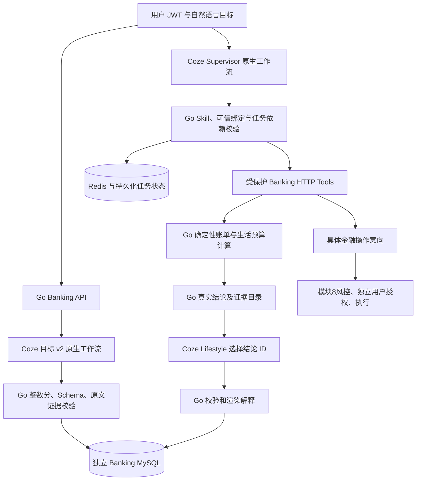

# P3：真实模型、Coze 原生工作流与可信解释

2026-10-13 实际完成本机联调。继续复用 Go/Gin/GORM/MySQL/Redis、模块8执行网关及现有任务调度器；没有修改 Coze 核心，没有开发前端，没有提前实施 P4。

## 实际实现

- 发布目标 v2 和 Lifestyle 原生 Start → LLM → End 工作流，更新 Supervisor 与三个已有专业解释工作流；保留原 v1 目标工作流 ID。配置使用当前实例实际模型、PAT 和发布 ID，不再把“缺少 Coze 配置”作为本机 P3 的状态。
- v2 解析返回 `parsed + spec` 或 `needs_information + missing_information`，并携带真实 `workflow_id`、`execute_id`。缺少配置、网络超时、非零返回码、缺失执行证据、非法 JSON、未知字段、错误来源证据均受校验，不返回假模型结果。
- 模型选取原文证据，Go 从明确的元/分和至多两位小数转换整数分，随后执行完整 JSON Schema 与来源、周期、金额角色、类别许可校验。`少花`与`储蓄`独立，负数、科学计数法、千分位或多金额歧义拒绝；手动创建目标仍要求正确整数分。
- Supervisor 的 Lifestyle 工具参数必须匹配调用方提供的目标、版本、预算、账单报告、资金计划绑定。模型不能发明 ID 或把只读工具标成 advice；执行仍验证归属、Skill、模式与真实来源。
- Lifestyle 解释采用确定性事实目录：Go 从已复算的方案生成结论和真实证据，模型仅选择一至三个已有 `finding_ids`，Go 渲染说明。未知/重复 ID、错误任务身份、额外自由文本或金额字段均拒绝。模型不能把有交易记录说成无记录，也不能改写预算或资金数值。
- 已有三个专业 Agent 的解释增加数字、执行声明与证据引用检查，去除不必要的用户身份、账户标识、交易备注、商户文本和原始目标文本；其自由文字不具有 Lifestyle 事实选择器的完整语义保证。
- 扩展现有任务输出、OpenAPI、原生画布生成器和幂等发布脚本。输出结果、执行 ID、选择的结论、引用证据和轨迹持久化并通过重启验收。

## 架构及依赖



本阶段真实调用方式是 Go 调度器运行 Coze 原生推理工作流，再通过已授权 HTTP executor 调用 Banking Tools。Coze 不持有数据库连接或银行 JWT 签名密钥。工具白名单、账户归属和金融执行隔离继续由 Go 校验；模型工作流没有执行资金工具。

当前源码依据：

- `backend/api/router/coze/api.go`：原生 create/save/publish 路由与 `/v1/workflow/run`。
- `backend/api/handler/coze/workflow_service.go`：对应工作流处理函数。
- `backend/domain/workflow/internal/canvas/examples/llm_node_with_skills/llm_node_with_workflow_tool.json`：真实原生节点形状。生成画布移除示例工具 ID。
- `deploy/banking/bootstrap-coze-local.mjs`：复用已验证的登录、空间、模型、PAT 和工作流 API；画布 SHA256 变化才更新版本。

原生 Agent 实体、HTTP Plugin 导入和 Plugin Wrapper 仍是配置/适配参考，未声称已部署这些实体。没有虚构 Agent-to-Agent API。

## 实际模型与工作流

CPU llama.cpp OpenAI-compatible 服务运行于本机 11435，Coze 通过 `http://host.docker.internal:11435/v1` 调用；使用 Qwen2.5 1.5B，真实模型 ID `100002`。模型文件由启动脚本校验官方 SHA256 `6a1a2eb6d15622bf3c96857206351ba97e1af16c30d7a74ee38970e434e9407e`。它是实际本地模型，本阶段未使用 GPT API。

|角色|本机实际已发布 Workflow ID|
|---|---|
|Supervisor|7694865787609153536|
|Billing|7694865791367249920|
|Subscription|7694865792856227840|
|Savings|7694865794450063360|
|Lifestyle|7696050871041261568|
|Goal v2|7696050872391827456|
|原 Goal v1，保留|7694865796199088128|

这些是本机实例 ID，不能复制到其他 Coze 实例直接使用。当前本机 `.env` 与 `.env.local` 已配置；公开 `.env.example` 保留占位。PAT、模型 API key 和登录信息只存于忽略的本地文件，不进入模型输入或交付文档。

真实本轮执行证据：Goal v2 `7696149184813989888`，Supervisor `7696149221266685952`，Lifestyle `7696149242292731904`。完整 HTTP 响应在 `output/module11/live.json`；不是硬编码返回。测试使用隔离 MySQL 模拟账户与持久化交易数据，模型通过真实 Coze API 运行。

## 目录与迁移

|位置|实际职责|
|---|---|
|`internal/lifestyle/parser.go`, `amounts.go`|解析状态、真实执行证据、来源金额计算|
|`internal/lifestyle/schema.go`|共享结构与语义校验|
|`internal/orchestrator/executor.go`, `explanation.go`|原生调用、绑定与解释边界|
|`internal/orchestrator/lifestyle_explanation.go`|Go 事实目录、引用校验及确定性渲染|
|`coze/banking/lifestyle-agent/`|v2 画布、Prompt、解释 Schema、配置及测试|
|`coze/banking/supervisor-agent/`|Supervisor 和专业解释生成器、Prompt、任务 Schema|
|`scripts/generate_lifestyle_openapi.py`|现有 REST/Tool API 新响应字段|
|`scripts/verify_model_live.py`|真实模型、资金不变、越权及重启验收|
|`scripts/record_model_delivery.py`|从实际日志和运行实例记录验收与文件哈希|

P3 无新增 SQL 迁移，也未修改历史迁移；实际数据库最大版本仍为 **010**。复用已有目标版本、生活方案、任务执行、结果 JSON 和执行轨迹存储。v2 解析本身不创建目标、不落账；解析执行 ID 返回调用方，**不自动写入 GoalVersion**。保存目标与编译方案由后续显式 API 完成。

完整实际文件清单与 SHA256：`output/module11/files.json`。它是本阶段主动修改清单，当前工作区 Git 元数据不可用，不冒充 Git diff。

## API 与错误契约

复用现有路由，无新增资金执行接口。完整 OpenAPI 3 文档：`api/openapi.yaml`、`api/coze-plugin.openapi.yaml`；运行时分别提供 `/openapi.yaml`、`/coze-plugin.openapi.yaml`。

|接口|P3 对接要求|
|---|---|
|`POST /api/v2/lifestyle-goals/parse`|`{text}`；parsed 含 spec，needs_information 不含 spec；返回真实执行 ID|
|`POST /api/v2/lifestyle-goals`|经校验 spec、原文、expected_version=0；用户身份与幂等键|
|`POST /api/v2/lifestyle-goals/{id}/compile`|真实目标版本及归属预算/历史报告/资金计划；仅生成建议|
|`POST /api/v1/orchestrations`|use_coze=true；绑定真实 lifestyle_plan_id 或完整编译来源|
|`GET /api/v1/orchestrations/{id}/result`|新增可选 explanation_evidence_ids / explanation_finding_ids；真实结果仍独立|
|`GET /api/v1/orchestrations/{id}/trace`|任务身份、尝试次数、原生 execute ID 与结果引用|

统一 Envelope 保留 code/message/request_id/trace_id/data。400 `INVALID_ARGUMENT/INVALID_TASK_PLAN`；401 `UNAUTHENTICATED`；403 `FORBIDDEN`；409 版本/状态/幂等冲突；422 `MODEL_OUTPUT_INVALID/TOOL_OUTPUT_INVALID`；503 `COZE_UNAVAILABLE/DEPENDENCY_UNAVAILABLE`。模糊目标可能得到合法 needs_information；非法模型输出仍返回错误，不降级成假解析。

PowerShell 中的 curl 示例（JWT 必须对应真实模拟用户；示例只调用解析和只读方案任务）：

```powershell
[IO.File]::WriteAllText((Join-Path $PWD 'output/p3-parse-input.json'), '{"text":"未来4个月每月少花800元，可以调整shopping，禁止转账。"}', [Text.UTF8Encoding]::new($false))
curl.exe -sS 'http://127.0.0.1:8090/api/v2/lifestyle-goals/parse' -H "Authorization: Bearer $env:BANKING_USER_JWT" -H 'Content-Type: application/json' --data-binary '@output/p3-parse-input.json'

# 此 ID 必须是当前用户已保存的真实生活方案。
$body = @{instruction='查询并解释已有生活方案，只安排一个 Lifestyle 查询任务。'; bindings=@{lifestyle_plan_id=$env:BANKING_LIFESTYLE_PLAN_ID}; use_coze=$true; max_attempts=1; timeout_ms=60000; strategy='sequential'} | ConvertTo-Json -Depth 10
[IO.File]::WriteAllText((Join-Path $PWD 'output/p3-task-input.json'), $body, [Text.UTF8Encoding]::new($false))
curl.exe -sS 'http://127.0.0.1:8090/api/v1/orchestrations' -H "Authorization: Bearer $env:BANKING_USER_JWT" -H "Idempotency-Key: $([guid]::NewGuid())" -H 'Content-Type: application/json' --data-binary '@output/p3-task-input.json'
curl.exe -sS "http://127.0.0.1:8090/api/v1/orchestrations/$env:BANKING_JOB_ID/result" -H "Authorization: Bearer $env:BANKING_USER_JWT"
```

## 启动和验收命令

在仓库根目录执行。Docker、Coze 和模型当前已运行；`Start-CozeLocalModel.ps1` 检测到 11435 已监听时会拒绝重复启动，不必再次执行。

```powershell
# 仅模型尚未运行、已具备下载并校验的模型与 llama-server.exe 时执行：
./deploy/banking/Start-CozeLocalModel.ps1 -ModelSize 1.5b

# 本机原生画布发布及配置，已有凭据不输出；其他实例需先建立自己的连接。
node deploy/banking/bootstrap-coze-local.mjs --p3 --publish --configure

./deploy/banking/Build-Image.ps1 -LocalBinaries -RuntimeBaseImage qingyingjin-banking-runtime:module10-cache
docker compose --env-file deploy/banking/.env -f deploy/banking/compose.yaml -f deploy/banking/compose.test.yaml -f deploy/banking/compose.coze-local.yaml up -d --no-build banking-service
curl.exe -sS http://127.0.0.1:8090/healthz
curl.exe -sS http://127.0.0.1:8090/readyz
```

本机外部网络必须保留 `coze-studio-debug_coze-network` overlay；公开端口通过测试 overlay 仅绑定 localhost。最终构建因远程 registry 曾出现 EOF，复用已验证的原非 root distroless 缓存基础镜像，并重新编译 server/migrate/seed 三个 Linux 二进制。该缓存 tag 只存在本机，其他环境可使用构建脚本默认 distroless 基础镜像。

```powershell
Push-Location services/banking-service
go build -buildvcs=false ./...
go vet -buildvcs=false ./...
go test -buildvcs=false -count=1 -json ./...
# 集成测试前停止 Banking worker，避免它抢占测试任务；保留 MySQL/Redis。
docker stop qingyingjin-banking-service-1
$env:BANKING_TEST_ENV_FILE='D:/智慧农业/deploy/banking/.env.local'
go test -buildvcs=false -tags=integration -count=1 -json ./...
Pop-Location
# 用上面的三份 Compose 配置恢复 banking-service。
python -X utf8 -m unittest discover -s coze/banking/supervisor-agent -p 'test_*.py' -v
python -X utf8 -m unittest discover -s coze/banking/lifestyle-agent -p 'test_*.py' -v
# Linux race 检查，使用本机已经存在的镜像及模块缓存，不访问网络：
docker run --rm --network none --mount 'type=bind,source=D:/智慧农业,target=/workspace,readonly' --mount "type=bind,source=$env:USERPROFILE/go/pkg/mod,target=/go/pkg/mod,readonly" -e GOTOOLCHAIN=local -e GOPROXY=off -e CGO_ENABLED=1 -w /workspace/services/banking-service golang:1.24-bookworm go test -buildvcs=false -race -count=1 ./internal/lifestyle ./internal/orchestrator ./internal/skills
python -X utf8 services/banking-service/scripts/verify_model_live.py
docker compose --env-file deploy/banking/.env -f deploy/banking/compose.yaml -f deploy/banking/compose.test.yaml -f deploy/banking/compose.coze-local.yaml restart banking-service
python -X utf8 services/banking-service/scripts/verify_model_live.py --restart
python -X utf8 services/banking-service/scripts/record_model_delivery.py
```

`verify_model_live.py` 使用 `TestLifestyleMySQLAPI` 实际保存的隔离测试数据；其业务测试数据不等于模型 fixture，脚本每次解析与任务推理均真实调用已发布 Coze 工作流。失败响应先落盘，不用假成功覆盖；重启检查仅读取同一任务与执行 ID。

## 实际结果

|检查|本轮结果|证据文件|
|---|---|---|
|Go build / vet|均 exit 0|`build-vet-final.json`|
|Go 全量单元|180 个测试事件通过，0 失败；17 个有测试包通过|`unit-final.jsonl`|
|MySQL/Redis 集成标签全量|314 个测试事件通过，0 失败，6 个可选 Docker 测试跳过；19 个有测试包通过|`integration-final.jsonl`|
|Linux Go race|lifestyle/orchestrator/skills 三包通过，无竞态报告|`race-final.log`|
|Python 画布/契约|Supervisor 7，Lifestyle 6，均通过|`supervisor-python.log`, `lifestyle-python.log`|
|真实模型全链路|准确解析、模糊目标不执行、三种安全方案、真实解释与证据、余额不变、错角色 403|`live.json`|
|真实容器重启|同一任务结果、执行 ID、方案摘要、证据和账户余额保留|`live-restart.json`|
|健康检查|healthz/readyz HTTP 200，MySQL/Redis/schema ready；容器 healthy|`acceptance.json`|

数字为 `go test -json` 的 test/subtest 终态事件数，集成标签运行同时包含单元测试，不宣称 314 个独立集成用例。6 个跳过为 ExecutionDocker、ExecutionDockerRestart、OrchestratorDockerWorker、OrchestratorDockerPersistence、AdaptiveSavingsDocker、AdaptiveSavingsDockerPersistence；本次单独执行了 P3 真容器及重启验收，不把这六项记为通过。

已修复的实测问题：Supervisor 错误选择只读工具模式；模型解释与真实交易相矛盾；验收脚本 Agent JWT 超过服务最大 TTL；新测试字段名错误。旧失败日志保留，不替换成成功记录。Windows Docker 遗留套接字故障通过保留目录备份并由用户恢复解决，没有重置数据库或数据卷。

## 未满足内容与 P4 条件

- 1.5B 模型未做统计可靠性或复杂指令性能测评；联调曾出现格式异常，后端会拒绝。配置真实发布 ID 不能保证所有自然语言一次成功。
- 原生 HTTP Plugin Wrapper 与独立 Agent 实体尚未正式导入/发布；本阶段验收的是原生推理工作流 + Go 白名单 HTTP 工具链。其配置参考不会冒充已发布功能。
- Billing/Subscription/Savings 原生解释工作流已更新，但本轮真实端到端验收集中于 Goal v2、Supervisor、Lifestyle；其他角色金额/工具结果和测试仍复用已实现模块，不声称新增真实模型全场景验收。
- 自由文字解释的完整语义保护目前仅 Lifestyle 通过事实目录实现；其他角色若需要同等级保证，应分别建立确定性结论目录。
- 未新增 GPT、FastAPI、PostgreSQL、LangGraph 或前端；不进行任何自动转账、订阅取消或关键预算修改。

**已具备进入 P4 的工程条件**：真实目标、任务、证据与解释契约可用，MySQL 金融核心持续独立运行。P4 应建立 FastAPI 身份映射与 PostgreSQL 只读投影、RLS/归属控制及重复/乱序处理；不要替换现有账本，不要复制银行签名秘密给模型，不启用双引擎同时调度同一任务。
