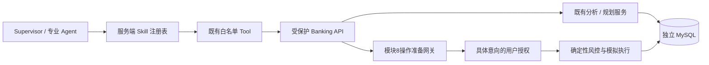

# 模块9：Skill 运行契约（产品升级 P1）

本阶段复用 Coze Studio、独立 Go Banking Service 和模块8执行网关。新增的是能力注册、版本绑定与权限边界；Lifestyle、评分、FastAPI、LangGraph、PostgreSQL及新前端尚未实现。

## 实现与依赖



- `internal/skills` 只依赖业务错误类型，拥有不可变契约；目录返回深拷贝。
- `internal/orchestrator` 复用注册表；提交、模型规划、动态任务插入、任务领取和 HTTP 执行前校验角色、工具、模式与版本。
- `internal/httpapi/skills.go` 按签名 JWT 的 Agent 角色验证专业接口；在网关未配置时也不恢复 Agent 的旧金融写权限。签名 task_id 优先于调用方请求头。
- `internal/goal/skill.go` 绑定既有内部解析尝试，不提供新公开 Tool，不使用规则伪造自然语言解析结果。
- `internal/execution/skill.go` 绑定既有操作准备；网关继续验证持久任务、租约、参数和用户授权。准备权限不等于执行权限。

| Skill / 版本 | 运行能力 |
|---|---|
| goal_compilation / 1 | 内部 `goal.parse`，真实解析尝试和工作流证据 |
| task_planning / 1 | supervisor 的 `plan_instruction`、`request_confirmation` |
| billing_analysis / 1 | billing 的六个既有只读账单工具 |
| subscription_analysis / 1 | subscription 的五个只读订阅工具 |
| savings_planning / 1 | savings 的 get/compare 查询和 replan 建议 |
| operation_preparation / 1 | subscription 的取消意向与 supervisor 的网关转交标记；内部 execution.prepare |

`require_gateway` 保持转交标记语义，不冒充已生成操作意向。`goal.parse` 不可作为外部任务工具提交。

## 数据库迁移与兼容

001–007 SQL 保持不变。008 为任务、目标版本和操作意向分别增加 `skill_id VARCHAR(64)` 与 `skill_version BIGINT`；009 为执行轨迹增加同名字段。009 独立于已经实际应用的008，避免改写其校验和。

迁移使用连接级锁，逐列检查 information_schema。已完成第一列的 DDL 可以安全重跑，迁移完成后写入版本校验和；服务 ready 检查迁移009。

只有同时省略 Skill 名称和版本，才允许固定旧映射。显式未知版本、缺少其中一个字段、跨 Skill/角色/工具调用及模式升级均被拒绝。历史合法任务在所属用户锁和任务状态条件下补齐字段，已完成任务不会重新执行；异常活动任务进入 review_required。终态异常数据不伪造成功元数据。

任务执行输入与输出保留 Skill 及规则版本，调用记录保留实际工具；轨迹存储 Skill 版本。目标版本关联 ParseID、ExecuteID、审计ID；网关意向关联操作ID及模块8审计记录。令牌和插件密钥不写入这些证据。

## API 与错误

- `GET /api/v1/skills`：普通用户可见六项目录；Agent 只能看签名角色允许的工具组合，不返回内部入口。
- `POST /api/v1/orchestrations`：TaskSpec 支持同时提供 `skill_id`、`skill_version`；合法旧请求保持兼容。
- 查询任务、结果与轨迹时可读取持久 Skill 字段。
- `INVALID_TASK_PLAN`（422）：未知/错配 Skill、版本、工具或模式。
- `FORBIDDEN`（403）：直接 API 的签名角色越权，或执行网关中伪造持久调度状态。
- `COZE_UNAVAILABLE`（503）和 `MODEL_OUTPUT_INVALID`（422）保持既有真实错误语义。

以下为 bash/curl 示例，USER_JWT 应来自现有受信任身份流程，不使用插件密钥替代用户授权。

```bash
curl -s http://127.0.0.1:8090/api/v1/skills \
  -H "Authorization: Bearer $USER_JWT"

curl -s http://127.0.0.1:8090/api/v1/orchestrations \
  -H "Authorization: Bearer $USER_JWT" \
  -H 'Content-Type: application/json' \
  -H 'Idempotency-Key: module9-billing-example-01' \
  -d '{"tasks":[{"key":"billing","agent_type":"billing","skill_id":"billing_analysis","skill_version":1,"tool":"get_transactions","execution_mode":"read_only","parameters":{"from":"2026-01-01T00:00:00Z","to":"2026-02-01T00:00:00Z"},"dependencies":[],"priority":0}]}'
```

API 全量 OpenAPI 为 `api/openapi.yaml`，原生插件合同为 `api/coze-plugin.openapi.yaml`。插件仍只有21条既有路径，没有添加用户授权、最终执行或任意 URL 工具。共享插件密钥依然绑定运营者指定用户，不声称已经实现多用户动态映射。

## 构建与启动（当前本地 Coze 环境）

从仓库根目录运行 PowerShell：

```powershell
./deploy/banking/Build-Image.ps1 -LocalBinaries
docker compose --env-file deploy/banking/.env `
  -f deploy/banking/compose.yaml `
  -f deploy/banking/compose.test.yaml `
  -f deploy/banking/compose.coze-local.yaml up -d --no-build banking-service
Invoke-RestMethod http://127.0.0.1:8090/healthz
Invoke-RestMethod http://127.0.0.1:8090/readyz
```

`compose.test.yaml` 保留本机13306/16379测试端口；`compose.coze-local.yaml` 保留实际 Coze 网络。省略它们会改变现有运行配置。生产环境无需开放测试端口，应按实际 Coze 部署选择对应网络。未修改任何 Coze 原生前端或底层引擎。

默认镜像 `qingyingjin-banking-service:module9`；可用 `BANKING_IMAGE` 覆盖 Compose 镜像或用构建脚本 `-ImageTag` 指定名称。镜像保持 nonroot、只读根文件系统和既有网络隔离配置。

## 实际验收（2026-10-13）

| 检查 | 实际结果 |
|---|---|
| go build -buildvcs=false ./... | 退出0 |
| go vet -buildvcs=false ./... | 退出0 |
| 全量单元，-count=1 | 154条测试通过记录，0失败、0跳过 |
| 全量 integration，-count=1 -p 1 | 273条通过记录，0失败、6跳过；包含单元及子测试 |
| Supervisor 原生 Schema/Canvas Python 测试 | 6项通过 |
| Linux Go1.24 -race | skills、orchestrator、execution 三个包通过 |
| 真实 MySQL DDL | 重复迁移和第一列提交后的恢复通过 |
| 真实受保护 HTTP | 合法旧任务、版本持久化、终态兼容、越权拒绝、未知版本人工复核通过 |
| 模块9 Docker 镜像 | 本地编译及 Docker 构建成功；服务 healthy |
| /healthz、/readyz | 实际HTTP200 |
| 部署 OpenAPI 与源码 | 字节相同；SHA256见 live.json |
| 真实 Coze Billing | 成功，工作流执行ID见 live.json |
| 真实 Coze Goal，明确周期/金额输入 | 解析与编译成功，Skill/ParseID/ExecuteID持久化 |
| 模糊约束目标的模型输出 | 实际被拒绝，MODEL_OUTPUT_INVALID；没有金融执行 |
| 实际容器重启 | Skill版本、任务执行次数1、目标解析尝试保持不变 |

模拟转账的在线 Docker 与重启验收日志分别为 `output/module9/docker-execution.jsonl`、`docker-restart.jsonl`。其 fixture 使用独立模拟用户，经模块8具体授权执行、重放及余额对账，不涉及真实资金。

所有日志在 `output/module9/`；`unit.jsonl`、`integration.jsonl` 为最终完整运行。首次失败日志单独保留：旧测试夹具错误模式、部署遗漏本地网络/测试端口已修复。没有把首次失败或跳过项计为通过。

全量集成的6个跳过项是需要在线服务/显式重启的专门测试；本阶段另外执行了转账在线/重启与 Skill 自有重启验收。未执行的其他专门 Docker 场景仍列在 `acceptance.json`。

复测命令在 banking-service 目录执行：

```powershell
go test -buildvcs=false -count=1 ./...
$env:BANKING_TEST_ENV_FILE='D:/智慧农业/deploy/banking/.env.local'
# 全量集成前暂停 banking-service worker，保持 MySQL/Redis 运行。
docker stop qingyingjin-banking-service-1
go test -buildvcs=false -count=1 -p 1 -tags integration ./...
docker start qingyingjin-banking-service-1
python -m pip install -r ../../coze/banking/supervisor-agent/requirements-test.txt
python -m unittest discover -s ../../coze/banking/supervisor-agent -p 'test_*.py'
python -X utf8 scripts/verify_skills_live.py
docker restart qingyingjin-banking-service-1
python -X utf8 scripts/verify_skills_live.py --restart
```

## 已知限制与后续接入

1. LLM 对含隐含限制的自然语言仍可能输出不合格事实，当前按原有 Schema/来源证据拒绝。明确输入已真实联通；不声称所有自然语言输入都成功。
2. Supervisor Prompt/Schema/配置是本地更新，Canvas生成器测试已验证会嵌入新契约；本次没有重新发布现有 Coze 工作流。真实已发布工作流的合法旧输出经固定映射兼容。
3. Lifestyle Agent、财务行为评分、expense_reduction目标语义及新栈服务属于后续阶段；目录中没有虚构这些可执行能力。
4. 当前工作区 Git 元数据不可用，未生成提交或PR；本模块变更清单及SHA256见 `output/module9/files.json`。
5. P2可以开始，但新能力必须注册真实版本，增加必要的 DTO/Schema、确定性计算与证据；不能给 Agent 增加 EXECUTE 权限，不能根据体重或限制饮食产生资金奖惩。
